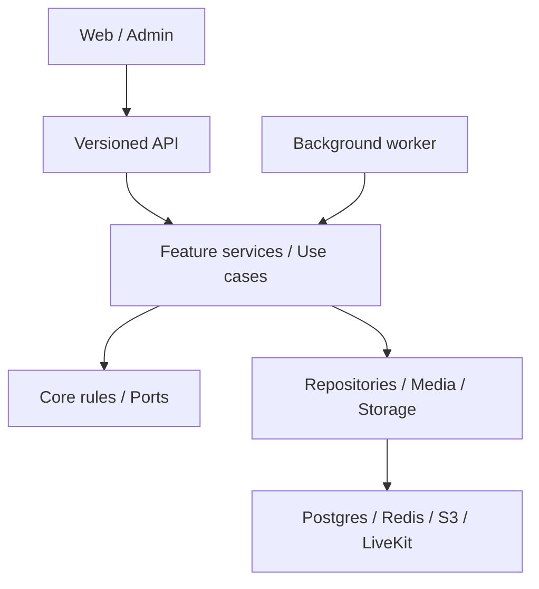

# TrustLens architecture

A modular monolith with separate web/admin clients and a background worker. HTTP contracts remain versioned and stable while implementation modules can be split independently. This reorganization does not rename database tables or public API paths.

The diagram shows conceptual application layers; the worker imports shared/core adapters, not the `trustlens_api` application. `.importlinter` enforces package boundaries. `trustlens-core` must not import frameworks or database/vendor libraries. Database and AI adapters implement ports without importing one another. Training code stays outside application dependencies.

## Backend ownership

- `api/v1/routers`: parse HTTP input, apply authentication/authorization dependencies, invoke application services and return envelopes. Existing mature endpoints can invoke core use cases directly. Some established router query assembly remains; move it into the appropriate feature service as that endpoint changes.
- `api/v1/schemas`: Pydantic wire contracts. Preserve camelCase JSON aliases; Python implementation names remain snake_case.
- `modules/messaging`: participant access, visible-message projections, edit/delete deadlines, clear/undo, listing grace period, voice validation/encryption, support evidence and archive operations.
- `modules/calling`: invitation/acceptance/owner leases, media credentials, device ownership, push subscriptions and cleanup. LiveKit transports live audio; the API retains call metadata, not recordings.
- `modules/profiles`, `modules/photos`, `modules/authentication`: application workflows for verified profiles, protected photos and Google authentication.
- `container.py`, `api/deps.py`: composition and per-request dependencies. A SQLAlchemy unit of work owns a request transaction; retries and locks enforce business consistency.
- `trustlens/db/models/*` and `repositories/*`: grouped by domain. Stable package exports register all 77 ORM tables and preserve caller imports.
- `exceptions/handlers.py`: domain/validation/HTTP errors become RFC 9457 responses. Unexpected failures are logged with correlation context and returned without internal details.

Thin top-level CLI compatibility modules remain deliberately: old archive/doctor/operator commands forward to the new modules. Removing these as “duplicates” would break existing scripts.

## Frontend ownership

`app/` composes routes. `features/` owns a business capability. Shared, domain-neutral controls live in `packages/ui`; cross-app transport and errors live in `packages/api-client`.

The messaging feature has explicit subfolders:

| Folder | Responsibility |
| --- | --- |
| `components` | Chat/call/recorder/player views, accessibility and user gestures |
| `hooks` | Queries, mutations, controller state, microphone/audio lifecycle and async cleanup |
| `providers` | App-wide call/player lifetime across route navigation |
| `calls`, `playback`, `recording` | Typed contracts, contexts, labels and feature helpers |
| `lib` | Binary audio transfer and upload progress |

`VoiceCalls.tsx` and `VoicePlayback.tsx` are compatibility export barrels, not second implementations. Routes keep their current public imports while providers/controllers are separate files.

## State rules

React Query owns server records and invalidation. Conversation-local drafts/dialog state stay in the chat controller. Call/player providers live above route boundaries. MediaRecorder, AudioContext, LiveKit Room, timers and generation counters are held in refs; they are not serializable application state. Async generations prevent permission/device/network completions from resurrecting a cancelled recording or ended call. The server remains authoritative for permissions, ownership and deadlines.

Existing auth/session state is app-local; token refresh is single-flight. Tokens are not persisted to localStorage. In-memory tokens still require normal XSS prevention. Do not mirror React Query data into another global store or create a global store per UI component.

## Retained business behavior

Sender editing and delete-for-everyone remain limited to 60 seconds. Clear changes only that user's history cutoff, with the existing 10-second undo. Original messages, versions and audit records are retained. A sold/inactive listing permits messaging during the 72-hour grace period; the conversation is read-only afterwards. Calls use the same availability gate. This package does not introduce a new “one verified device per account” policy.

## Scaling

Scale stateless API containers behind a trusted HTTPS proxy; do not hold authoritative call ownership only in memory. PostgreSQL locks and call runtime records coordinate workers/devices. Redis queues/rate limits are shared. Object storage holds uploads; LiveKit carries media and requires its own capacity/network design. Apply migrations once per release before replacing application containers. More replicas do not replace index design, bounded pagination, storage quotas, monitoring or load testing.

See [API guide](docs/development/API_STRUCTURE.md), [environment guide](docs/development/ENVIRONMENT.md), and [verification report](docs/development/REFACTOR_REPORT.md).
