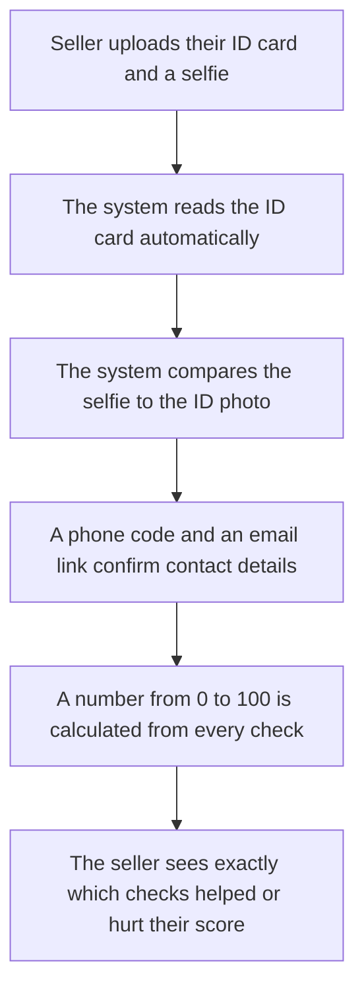

# TrustLens, Explained Simply

A plain-language guide to what TrustLens is, how it works, and the questions a viva panel is likely
to ask about it. Written so that Haseeb and Muttayab can explain the project fluently without leaning
on jargon, and so a non-technical committee member can follow along.

---

## 1. What is this project, in one paragraph?

TrustLens is a website that answers one question for an online shopper: **"Can I trust this
seller?"** A seller signs up, proves who they are (an ID card check, a phone check, an email check),
and lists their products. TrustLens turns all of that proof into one number from 0 to 100 — the
Trust Score — plus a plain-English explanation of why the number is what it is. A buyer sees the
score and the reasons before they ever hand over money.

## 2. What real-world problem does it solve?

Buying from a stranger on an online marketplace (an OLX-style site, a rental listing, a used-car ad)
is a leap of faith. Scammers exploit exactly the same five tricks over and over: a fake profile, a
stolen product photo, a throwaway phone number that stops answering after payment, a fresh email
address created five minutes ago, and a price that's "too good to be true." A buyer has no easy way
to check any of this before paying. TrustLens checks all five, automatically, and shows the result as
one honest number instead of five separate mysteries.

## 3. What happens when a seller verifies themselves — step by step

- **Step A — upload:** the seller takes a photo of their national ID card and a selfie. Why this
  step exists: without proof of a real, matching identity, every other check in the system is
  meaningless — someone could still be lying about who they are.
- **Step B — read the ID card:** a computer-vision tool reads the text off the card (name, ID
  number, dates) the same way a human eye would, just automatically and instantly.
- **Step C — compare faces:** the system checks whether the selfie is the same person as the photo
  on the card. This is the single hardest check for a scammer to fake, which is why it's worth the
  most points.
- **Step D — phone and email:** a text-message code and an email link confirm the seller actually
  controls that phone number and inbox, not a throwaway one.
- **Step E — calculate the score:** every completed check contributes points. Nothing about the
  score is guessed — it's added up from real evidence, the same way every time.
- **Step F — explain the score:** the seller (and any buyer looking them up) sees exactly which
  checks passed, which didn't, and — for the seller — what to fix to improve it.

## 4. The three main parts of the system, explained with a restaurant analogy

Think of TrustLens like a restaurant:

| Restaurant part                                                                | TrustLens equivalent             | What it does                                                                        |
| ------------------------------------------------------------------------------ | -------------------------------- | ----------------------------------------------------------------------------------- |
| **The dining room** (what customers see and interact with)                     | **Frontend** (the website)       | Where sellers upload documents and buyers see the score                             |
| **The kitchen** (where the actual cooking happens, out of sight)               | **Backend + background workers** | Where ID cards get read, faces get compared, and the score gets calculated          |
| **The recipe book and pantry inventory** (the source of truth for what's true) | **Database**                     | Stores every seller, every check result, and every score ever computed, permanently |

A customer never sees the kitchen directly — they just see the dining room and get their food. A
buyer never sees the ID-reading or face-comparing happen — they just see the finished Trust Score.
And just like a restaurant keeps a recipe book so the same dish tastes the same every time, TrustLens
keeps a rulebook (the scoring rules) in its database so the same evidence always produces the same
score.

## 5. The technology stack, explained one by one

| Technology                                     | What is it?                                                                                                           | Why did we use it?                                                                                                                               | What would happen without it?                                                                                                                                  |
| ---------------------------------------------- | --------------------------------------------------------------------------------------------------------------------- | ------------------------------------------------------------------------------------------------------------------------------------------------ | -------------------------------------------------------------------------------------------------------------------------------------------------------------- |
| **Next.js / React**                            | A framework for building interactive websites                                                                         | It's what the proposal specified, and it lets the same website work well on both desktop and mobile browsers                                     | We'd have to hand-build page routing and re-render logic that Next.js already provides — much more work for the same result                                    |
| **Tailwind CSS**                               | A way of styling a website by combining small utility classes instead of writing custom CSS files                     | Faster to build a consistent look across many screens                                                                                            | Every screen's styling would drift slightly, and simple design changes would take much longer                                                                  |
| **Python + FastAPI**                           | The backend programming language and web framework                                                                    | The proposal specifies Python (it's also the natural fit for AI/ML code); FastAPI is fast, modern, and automatically generates API documentation | We'd need a separate framework for API docs and lose FastAPI's built-in request validation                                                                     |
| **PostgreSQL**                                 | The database that stores everything permanently                                                                       | The proposal specifies it; it's a mature, reliable, free database that handles complex data relationships well                                   | A weaker database might lose data under concurrent access or lack the safety checks TrustLens relies on (like "a seller can only ever have one current score") |
| **Redis**                                      | A very fast, temporary, in-memory data store                                                                          | Used as a cache (so repeated score lookups are instant) and as the to-do list for background jobs                                                | Every score lookup would have to hit the slower main database every single time                                                                                |
| **OpenAI / Claude API**                        | A large language model that can read text and understand it                                                           | Used to read a product listing and flag suspicious language (like "pay now, hurry, no refunds")                                                  | The system would only be able to catch scam patterns a programmer manually thought to write rules for                                                          |
| **OpenCV + EasyOCR (or the lighter RapidOCR)** | Computer-vision libraries that read text out of an image                                                              | This is what "reads" the ID card automatically                                                                                                   | A human staff member would have to manually type out every ID card — completely unworkable at scale                                                            |
| **DeepFace (or the lighter InsightFace)**      | A face-recognition library                                                                                            | This is what compares the selfie to the ID photo                                                                                                 | There would be no automatic way to confirm the person uploading is the person on the ID                                                                        |
| **A custom-trained scam-listing classifier**   | A small machine-learning model trained specifically on TrustLens's own labelled examples of scam vs. genuine listings | The LLM alone is a general-purpose tool; a purpose-trained model can specialise on marketplace-scam patterns specifically                        | We'd rely entirely on the general-purpose LLM, with no way to measure or improve accuracy on this exact task over time                                         |
| **Docker**                                     | A way to package and run software in a consistent, portable container                                                 | Lets the whole system run identically on any machine, including a lab computer with no internet, for the demo                                    | Setting up the exact right versions of Python, Node, Postgres, and Redis by hand on every machine would be fragile and slow                                    |

> **Note for the viva — "why not the more famous alternative?"** A panel may ask why not
> Django/Angular/MongoDB. Short answer: the proposal specified this exact stack, and within it every
> individual choice (FastAPI over Flask/Django, PostgreSQL over MongoDB) was made because the data
> has real structure and real relationships — a seller has exactly one current score, a score has
> many signal results, an appeal points at one specific score — which a relational database enforces
> and a document database does not.

## 6. The core "brain" of the system — the Trust Score engine

Think of the scoring engine as a strict, honest teacher grading a test with 14 questions worth
different amounts of points (100 points total). A few important rules make the grading fair:

- **AI never grades the test — it only supplies answers.** The face-comparison tool and the
  listing-reading AI produce _evidence_ (a similarity number, a suspicion label), but a separate,
  simple, and completely predictable rulebook is what turns evidence into points. This matters
  because if a seller disagrees with their score, humans can check the rulebook and see exactly why
  — an AI "just trust me" answer wouldn't be defensible.
- **If a question couldn't be asked, it doesn't count against you.** If the AI that reads listings
  is temporarily down, that question is skipped entirely — not marked wrong. The final score is
  scaled to only the questions that were actually asked.
- **Some questions are so important that failing them caps your grade, no matter how well you did on
  everything else.** If the face-match check clearly fails, the seller can score at most 25 out of
  100, even if every other check passed — because an unproven identity should never look "trustworthy"
  on paper.
- **Not enough evidence yet is a different answer from "you failed."** A brand-new seller who hasn't
  completed any checks gets an honest "unknown" status, shown in neutral grey — never red (which
  would wrongly imply proven fraud) and never green (which would wrongly imply proven trust).

## 7. How we keep the system safe and fair

- **A seller's ID number and biometric face data are encrypted**, and the raw ID card images are
  automatically deleted 90 days after a decision is made — TrustLens keeps only what it needs to
  explain a score, not the sensitive documents themselves forever.
- **A borderline face-match result goes to a human, not an automatic rejection.** Face-recognition
  technology is known to be slightly less accurate for some demographic groups, so instead of a hard
  automatic "fail" near the decision boundary, TrustLens routes those cases to a human reviewer.
- **A seller who disagrees with their score can appeal it**, and a human reviewer looks at the exact
  same evidence the system saw before deciding.
- **We do not perform real government ID verification.** There is no public way for a student project
  to check an ID card against Pakistan's national database (NADRA), and we say so honestly rather
  than implying a stronger guarantee than the system actually provides.

## 8. Glossary

| Term        | Plain-English meaning                                                                              |
| ----------- | -------------------------------------------------------------------------------------------------- |
| Trust Score | The 0–100 number TrustLens gives a seller                                                          |
| Risk band   | The score translated into LOW / MEDIUM / HIGH / UNKNOWN risk                                       |
| Signal      | One individual check (e.g. "is the phone number verified?")                                        |
| OCR         | The computer reading text out of a photo                                                           |
| Face match  | The computer comparing two photos to see if they're the same person                                |
| API         | A way for other websites (like a marketplace) to ask TrustLens for a seller's score automatically  |
| Backend     | The part of the system that does the actual work, out of sight of the user                         |
| Worker      | A background process that does slow work (like reading an ID card) without making the website wait |
| Appeal      | A seller formally asking a human to review their score                                             |
| Hard cap    | A rule that limits the maximum possible score when something critical failed                       |

## 9. Likely viva questions and honest answers

1. **"How is this different from a marketplace that already has OTP/phone verification, like OLX?"**
   OTP alone only proves someone controls a phone number — it says nothing about whether their
   identity is real, whether their listing is suspicious, or whether they're running multiple
   accounts from one device. TrustLens combines seven independent signals into one explainable
   score; OTP is one of the seven, not the whole product.

2. **"Did you validate real-world OCR and face-match accuracy?"**
   Honestly, not yet. We built and tested both engine pairs (a heavier, well-established pair and a
   lighter ONNX-based pair) against synthetic test images and confirmed both work correctly in
   isolation. We have not yet run either against real, consented CNIC photographs, because collecting
   that dataset ethically takes real time and is explicitly the students' own current task.

3. **"What's the biggest weakness in the current system?"**
   The custom-trained scam-listing classifier. It scores very well (0.906 F1) on its own training
   data, but when we manually checked it against real Pakistani marketplace scam listings, it only
   caught 1 of 7. That's because its training data is English job-advert scam text, not local
   marketplace listings. We found this ourselves by deliberately testing across different data
   sources — and specifically because of that result, the classifier is **not yet turned on** as a
   live scoring input.

4. **"Why didn't you build your own OCR/face-recognition models from scratch?"**
   Training a competitive OCR or face-recognition model from scratch requires enormous labelled
   datasets and compute far beyond an FYP's scope. Using established, well-tested pretrained models
   behind our own interfaces lets us focus our own engineering effort on what's actually novel here:
   combining multiple signals into one explainable, appealable score.

5. **"Can a seller game the system?"**
   Every signal is independently checked and cross-referenced (e.g. one CNIC number reused across
   several accounts is detected even though the number itself stays encrypted), and critical checks
   apply hard caps that a weighted average alone can't paper over. It's not un-gameable, but it's
   deliberately not a system where passing one easy check can hide failing a hard one.

6. **"Why is the score explainable instead of just having the AI say 'trust this seller: 74%'?"**
   Because a seller has a right to know exactly why they got the score they did, and to appeal a
   specific, reproducible decision. An AI's raw opinion changes if you ask it twice and can't be
   defended in an appeal. Our score is built from a fixed, versioned rulebook applied to stored
   evidence — the same inputs always produce the same output, and every point is traceable.

7. **"What happens if the AI listing-analysis service goes down?"**
   That signal is marked "unavailable" and excluded from both the numerator and denominator of the
   score — it is never silently treated as a failure. A seller's score is never punished for an
   outage that wasn't their fault.

8. **"Is the admin panel finished?"**
   No, and we say so directly: the identity/appeal review queue and scoring-model management work
   end-to-end, but seller search, seller detail pages, and the audit-log viewer are still open work.

9. **"Is the system deployed publicly?"**
   Not yet. It runs fully and correctly locally via Docker, and the deployment plan (Vercel + Fly.io
   - free-tier managed databases, chosen to cost $0/month) is designed and partly rehearsed, but the
     actual public deployment hasn't happened yet.

10. **"How do you handle a face-match result that's borderline, not clearly pass or fail?"**
    It goes to a human reviewer instead of an automatic decision. This is a deliberate design choice
    because face-matching technology is known to have uneven accuracy across some demographic groups,
    and an automatic hard "fail" in that uncertain zone would be unfair.

11. **"What's stored about a seller's ID card, and for how long?"**
    The raw images are stored encrypted and privately, and automatically deleted 90 days after a
    final decision. The extracted ID number and birth date are also encrypted at rest and never
    returned in full by any API — only the last 4 digits of the ID number, if shown at all.

12. **"Why PostgreSQL and not a NoSQL database?"**
    The data has strict, enforceable relationships that matter for correctness — a seller must have
    exactly one current score, an override must always carry a reason, one CNIC must be detectable
    across multiple accounts. A relational database enforces these as real constraints; a document
    database would leave them as things a developer has to remember to check.

13. **"How did you test the scoring logic itself?"**
    It's isolated as pure, dependency-free code specifically so it can be unit-tested exhaustively —
    every signal passing, every signal failing, a signal being unavailable, the exact score at a risk
    -band boundary (39 vs. 40), and every hard-cap scenario are all individually tested.

14. **"What would you do differently if you started over?"**
    Two honest answers: collect real CNIC/face test images from week one instead of leaving it as a
    student task that's still outstanding late in the project, and label a small real target-domain
    dataset for the scam classifier before training the first version, rather than discovering the
    English-job-advert mismatch after training.

15. **"Why is nothing deployed publicly yet, this late in the project?"**
    Deployment was deliberately sequenced after the core product worked correctly locally, because a
    half-working public demo is worse for a viva than a fully-working local one — and the free-tier
    hosting research (proving the whole stack can run at $0/month) took real engineering time of its
    own, documented in the go-live plan.
