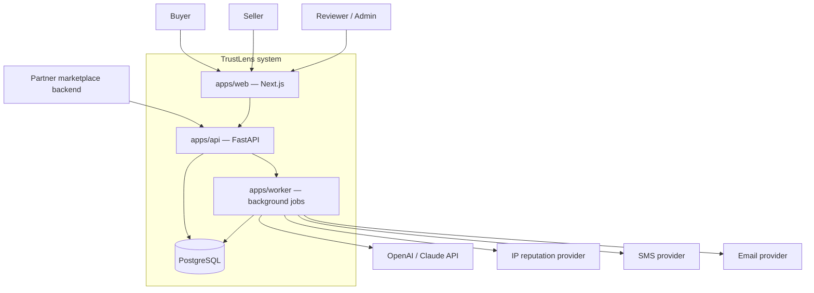
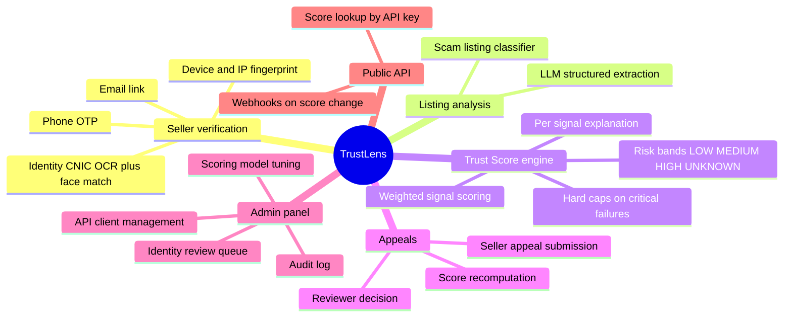
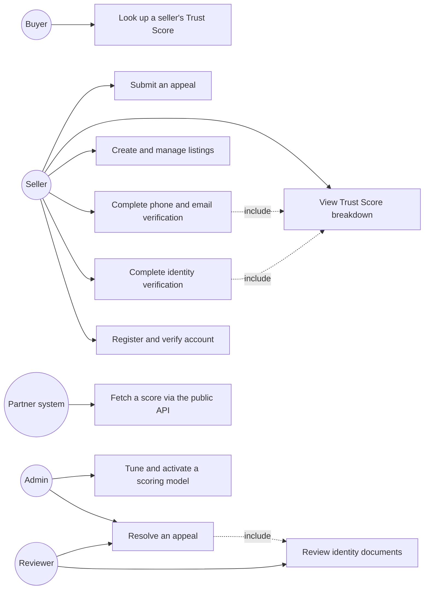
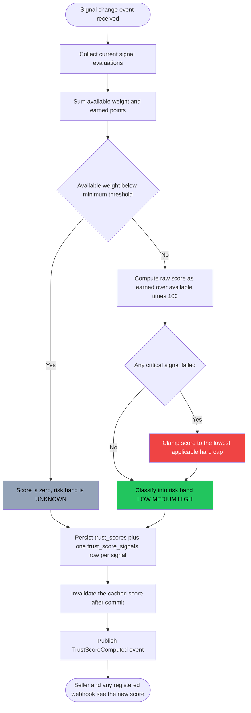

# Software Requirements Specification

**TrustLens — AI-Powered Seller Trust Verification System for Online Marketplaces**

Final Year Project, School of Software Engineering, Minhaj University Lahore
Haseeb Ur Rehman (2022F-mulbsswe-043) · Muhammad Muttayab (2022F-mulbsswe-012)
Supervisor: Mam Misbha · FYP Coordinator: Muhammad Kamran

Prepared against IEEE Std 830-1998 (Recommended Practice for Software Requirements Specifications).

---

## 1. Introduction

### 1.1 Purpose

This document specifies the functional and non-functional requirements of TrustLens, a web
application and REST API that verify whether an online-marketplace seller is genuine or fraudulent
and publish a single explainable **Trust Score (0–100)** with a risk level and the reasons behind
it. It is written for the project supervisor, the FYP evaluation committee, and any developer who
continues the codebase after handover.

Every requirement in this document is traced to either the original FYP proposal (`FYP_Proposal_TrustLens.pdf`)
or to a documented assumption filling a gap the proposal left open (§2.6). No requirement here
describes a feature that does not exist in the codebase's design — this is a specification of what
was built and designed, written after most of the implementation, not a forward-looking wishlist.

### 1.2 Scope

TrustLens consists of:

- A **seller-facing web application** (`apps/web`) where a seller registers, completes identity,
  phone, email and device verification, lists products, and views their Trust Score.
- A **buyer-facing public page** where anyone can look up a seller's score without an account.
- An **admin/reviewer panel** for staff to review flagged identities, resolve appeals, and tune the
  scoring model.
- A **backend API** (`apps/api`) serving both the web app (internal, JWT-authenticated) and partner
  marketplaces (`/public/v1`, API-key authenticated).
- A **background worker** (`apps/worker`) that runs OCR, face matching, LLM listing analysis, and
  score computation asynchronously.

**In scope** (from the proposal, §2.6 of `01-project-overview.md` reproduced here as Table 1.2‑a):

| #   | Feature                                         |
| --- | ----------------------------------------------- |
| F1  | Identity verification — CNIC OCR + face match   |
| F2  | Phone OTP verification                          |
| F3  | Email verification and checks                   |
| F4  | Device and IP / VPN detection                   |
| F5  | AI listing analysis                             |
| F6  | Explainable Trust Score engine with risk levels |
| F7  | Admin and appeal panel                          |
| F8  | Public Trust Score API                          |

**Out of scope** (the proposal's own "Future Scope" list — see [19 — Future Improvements](../../docs/19-future-improvements.md)
for the seams already built for each): reverse-image stolen-photo detection, chat scam detection,
direct marketplace integrations, seller reputation history, and a mobile application.

Also explicitly out of scope for this FYP: real NADRA/biometric government verification (no public
NADRA API exists at FYP level — TrustLens performs document plausibility and face-match evidence
only, never a government identity check), and any claim of validated real-world OCR/face-match
accuracy (see §6.7 and the Test Documentation banner).

### 1.3 Definitions, acronyms and abbreviations

| Term                  | Meaning                                                                                     |
| --------------------- | ------------------------------------------------------------------------------------------- |
| CNIC                  | Computerized National Identity Card — Pakistan's national ID document                       |
| Trust Score           | The explainable 0–100 score TrustLens computes for a seller                                 |
| Risk band             | One of LOW / MEDIUM / HIGH / UNKNOWN, derived from the score                                |
| Signal                | One scoreable piece of evidence (e.g. `PHONE_VERIFIED`) contributing points to the score    |
| OCR                   | Optical Character Recognition — extracting text from the CNIC image                         |
| Face match            | Comparing a selfie against the photo on the submitted CNIC                                  |
| VOIP number           | An internet-routed phone number, not a mobile SIM — a common throwaway-number pattern       |
| Disposable email      | An email from a temporary/throwaway-email provider                                          |
| JWT                   | JSON Web Token — the internal API's bearer-token format                                     |
| RBAC                  | Role-Based Access Control                                                                   |
| ARQ                   | Async Redis Queue — the background job runner                                               |
| IDOR                  | Insecure Direct Object Reference — accessing another user's resource by guessing its ID     |
| Hard cap              | A ceiling the score cannot exceed when a critical signal fails, regardless of other points  |
| Appeal                | A seller's formal request to have a specific computed score reviewed by a human             |
| Partner / marketplace | An external platform (OLX-style, rental, vehicle, freelance) integrating via the public API |

### 1.4 References

1. `FYP_Proposal_TrustLens.pdf` — the approved FYP proposal (Minhaj University Lahore, Form No. 2)
2. IEEE Std 830-1998 — Recommended Practice for Software Requirements Specifications
3. `docs/01-project-overview.md` through `docs/20-go-live-plan.md` — the engineering design documentation this SRS is grounded in
4. `TASKS.md`, `REMAINING.md` — build history, defect log and outstanding work
5. RFC 9457 — Problem Details for HTTP APIs (the error-response format TrustLens uses)
6. RFC 6238 — TOTP (the MFA mechanism designed for admin/reviewer accounts)

### 1.5 Document overview

Section 2 describes the product at a high level: perspective, functions, users, environment,
constraints and assumptions. Section 3 specifies external interfaces. Section 4 lists functional
requirements by module. Section 5 gives the use-case model. Section 6 specifies non-functional
requirements. Section 7 covers legal/regulatory requirements. Appendices hold the traceability
matrix, domain reference tables, and the environment-variable reference.

---

## 2. Overall description

### 2.1 Product perspective

TrustLens is a new, self-contained product — it does not replace or extend an existing system. It
sits **between** a buyer and a seller as a trust layer, and it exposes itself to marketplaces as an
external service they can optionally integrate.

### 2.2 Product functions

### 2.3 User classes and characteristics

| User class                          | Technical skill assumed                              | Frequency of use                               | Primary need                                                                   |
| ----------------------------------- | ---------------------------------------------------- | ---------------------------------------------- | ------------------------------------------------------------------------------ |
| **Buyer** (anonymous or registered) | None — general internet user                         | Occasional, pre-purchase                       | Judge a seller quickly before paying                                           |
| **Seller**                          | Basic — comfortable uploading a photo and a document | Regular, until fully verified, then occasional | Get verified, understand and improve their score                               |
| **Reviewer** (staff)                | Trained on the admin tool                            | Daily                                          | Work the identity/appeal queue accurately and quickly                          |
| **Admin** (staff)                   | Trained, elevated trust                              | As needed                                      | Everything a reviewer does, plus tune the scoring model and manage API clients |
| **Partner marketplace** (machine)   | Developer integrating a REST API                     | Continuous, automated                          | Low-latency, reliable score reads with no PII                                  |

Full permission matrix and user journeys: `docs/09-user-roles.md`.

### 2.4 Operating environment

| Layer                                  | Requirement                                                                                                                                                                    |
| -------------------------------------- | ------------------------------------------------------------------------------------------------------------------------------------------------------------------------------ |
| Buyer/seller/admin client              | Any modern evergreen browser (Chrome, Firefox, Safari, Edge) on Windows, macOS, Linux, iOS or Android — the proposal specifies cross-platform browser support, not native apps |
| Server runtime                         | Docker containers; Python 3.12 (API, worker), Node.js 20+ (web)                                                                                                                |
| Database                               | PostgreSQL 16                                                                                                                                                                  |
| Cache/queue                            | Redis 7                                                                                                                                                                        |
| Object storage                         | S3-compatible (MinIO in development; Cloudflare R2 or equivalent in production)                                                                                                |
| Deployment (as designed, not yet live) | Frontend on Vercel; backend/worker originally targeted at Railway, later revised to Fly.io for a $0/month footprint (`docs/20-go-live-plan.md`) — see §2.6 assumption A16      |

### 2.5 Design and implementation constraints

| #   | Constraint                                                                                                                                                         | Reason                                                                                                                                                                                    |
| --- | ------------------------------------------------------------------------------------------------------------------------------------------------------------------ | ----------------------------------------------------------------------------------------------------------------------------------------------------------------------------------------- |
| C1  | Frontend must be Next.js/React + Tailwind CSS                                                                                                                      | Proposal mandate                                                                                                                                                                          |
| C2  | Backend must be Python + FastAPI                                                                                                                                   | Proposal mandate                                                                                                                                                                          |
| C3  | Database must be PostgreSQL, with Redis as cache                                                                                                                   | Proposal mandate                                                                                                                                                                          |
| C4  | AI engine must use OpenAI/Claude API + OpenCV + EasyOCR (or an equivalent computer-vision stack) + DeepFace-class face matching + a custom-trained scam classifier | Proposal mandate                                                                                                                                                                          |
| C5  | Must run fully offline via Docker Compose with no paid API key (`USE_FAKE_AI=true`)                                                                                | An FYP must be demonstrable on a lab machine or in a viva room with unreliable internet, at zero cost                                                                                     |
| C6  | Must not perform real NADRA/government biometric verification                                                                                                      | No public NADRA API exists at FYP access level; doing so would also raise a regulatory issue outside project scope                                                                        |
| C7  | Deployment budget is effectively $0/month                                                                                                                          | Two-student FYP with no operating budget; every paid third-party dependency sits behind a port with a free/offline fallback                                                               |
| C8  | Two-person engineering team, one supervisor-facing FYP timeline                                                                                                    | Shapes the "modular monolith, not microservices" architectural decision (ADR-0001, ADR-0004)                                                                                              |
| C9  | AI-derived signals may never directly determine the score                                                                                                          | An LLM/classifier output is evidence with a confidence value; a deterministic, versioned rule set converts evidence to points — required for appealability and reproducibility (ADR-0002) |

### 2.6 Assumptions and dependencies

The proposal is a four-page form; it leaves genuine gaps. Each is filled with the most defensible
choice and recorded here so a supervisor can overrule any single one without disturbing the rest of
the design (full detail: `docs/01-project-overview.md` §7).

| #   | Assumption                                                                                                                                                        | Failure impact if wrong                                                                                                           | Mitigation                                                                                         |
| --- | ----------------------------------------------------------------------------------------------------------------------------------------------------------------- | --------------------------------------------------------------------------------------------------------------------------------- | -------------------------------------------------------------------------------------------------- |
| A1  | Risk bands: 0–39 HIGH, 40–69 MEDIUM, 70–100 LOW                                                                                                                   | Bands would need re-tuning                                                                                                        | One config row in `scoring_models`; no code change                                                 |
| A2  | "CNIC" = Pakistani Computerized National Identity Card, front + back                                                                                              | OCR field templates targeted at the wrong document                                                                                | OCR field templates are isolated in `cnic_parser.py`                                               |
| A3  | Sellers self-register, or are partner-initiated via the public API                                                                                                | —                                                                                                                                 | `/public/v1/sellers` POST already exists                                                           |
| A4  | Listings enter via URL or manual form, no marketplace crawling                                                                                                    | —                                                                                                                                 | `listings.source` enum already reserves `API`/`IMPORT`                                             |
| A5  | Auth is email+password with JWT access + rotating refresh cookie                                                                                                  | —                                                                                                                                 | Isolated in `apps/api/core/security.py`                                                            |
| A6  | CNIC/selfie images live in S3-compatible object storage, never in Postgres                                                                                        | —                                                                                                                                 | One storage adapter behind a port                                                                  |
| A7  | IP/VPN intelligence comes from a third-party API behind a port, with an offline ASN fallback                                                                      | Paid key unavailable at demo time                                                                                                 | Offline fallback is the default; no demo dependency on a live key                                  |
| A8  | OTP delivery is an SMS provider behind a port; console/dev driver prints the code locally                                                                         | No Twilio account provisioned yet                                                                                                 | Console driver is production-safe as a **documented limitation**, not silently broken              |
| A9  | Transactional email is a provider behind a port; Mailpit captures mail in development                                                                             | —                                                                                                                                 | One adapter                                                                                        |
| A10 | Admin panel is a route group inside the same Next.js app, not a separate deployment                                                                               | —                                                                                                                                 | Route group only                                                                                   |
| A11 | The scam classifier trains on a hand-labelled dataset assembled by the team                                                                                       | Classifier quality depends on data the team must collect (tracked as P7-02, currently the project's largest open risk — see §6.7) | `apps/ml` is versioned and swappable                                                               |
| A12 | English UI only; i18n-ready structure, no second locale shipped                                                                                                   | —                                                                                                                                 | `packages/i18n` seam exists                                                                        |
| A13 | Partner marketplaces are API clients, not tenants — one shared seller graph                                                                                       | —                                                                                                                                 | `marketplaces` table scopes external references                                                    |
| A14 | A score is valid for 30 days or until an input signal changes                                                                                                     | —                                                                                                                                 | `trust_scores.valid_until`, nightly staleness sweep                                                |
| A15 | Payments/billing are out of scope; API quota is enforced but not billed                                                                                           | —                                                                                                                                 | —                                                                                                  |
| A16 | Hosting target moved from Railway (proposal's literal wording) to Fly.io + free-tier managed services, decided 12 Aug 2026, to reach a genuine $0/month footprint | Deployment is not yet live regardless of host                                                                                     | `docs/20-go-live-plan.md` documents the swap and the measured RAM/image-size numbers that drove it |

---

## 3. External interface requirements

### 3.1 User interfaces

- **Public score page** (`/seller/{handle}`) — server-rendered, no login required, works for any
  buyer including one with no TrustLens account. Must render correctly at 360px and 1440px widths
  (this is the screen shown in the project's live demo).
- **Seller portal** (`/dashboard/...`) — authenticated, feature-sliced screens for verification,
  listings, trust score, appeals, and account settings.
- **Admin/reviewer panel** (`/admin/...`) — authenticated, role-gated, for the identity/appeal
  review queue and (partially built — see §6.8) scoring-model administration.
- All interactive UI must meet WCAG 2.1 AA-oriented practices already designed into the component
  library: colour is never the sole carrier of meaning for a risk badge, all interactive elements
  are keyboard-operable, and focus is trapped correctly in dialogs.

### 3.2 Hardware interfaces

- **Camera** — used by the browser's file/camera input for selfie capture during identity
  verification. No native camera API is used; this is a standard HTML file input with a `capture`
  hint, so any device with a camera and a modern browser satisfies this.
- No other hardware interface (no GPS, no biometric sensor, no specialised scanner) is required or
  used.

### 3.3 Software interfaces

| External system                                                              | Purpose                                                                     | Data crossing the boundary                                 |
| ---------------------------------------------------------------------------- | --------------------------------------------------------------------------- | ---------------------------------------------------------- |
| OpenAI API / Anthropic (Claude) API                                          | Structured listing-risk analysis (labels, findings, price-deviation signal) | Listing text out; risk labels and findings in. No PII sent |
| IP-reputation provider (pluggable; offline ASN list as the FYP-safe default) | VPN/proxy/datacenter detection for the NETWORK signal                       | IP address out; reputation flags in                        |
| SMS provider (Twilio-class; console driver in development)                   | OTP delivery for phone verification                                         | Phone number + code out                                    |
| Email provider (SMTP/Resend-class; Mailpit in development)                   | Verification links, password reset, appeal notifications                    | Email address + templated content out                      |
| Object storage (S3-compatible)                                               | CNIC images, selfies, listing images, model artifacts                       | Binary files, never public                                 |

### 3.4 Communications interfaces

- **Protocol:** HTTPS (TLS 1.2+) in any deployed environment; plain HTTP only on `localhost` in
  development.
- **Internal API auth:** JWT bearer token (access) + httpOnly rotating refresh cookie.
- **Public API auth:** `Authorization: Bearer tl_live_<prefix>.<secret>` API key.
- **CORS:** strict origin allowlist; wildcard `*` is rejected at application startup in production.
- **Response format:** JSON, camelCase on the wire; errors as `application/problem+json` per RFC 9457.

---

## 4. Functional requirements

Requirements are grouped by module and numbered `FR-<module>-<seq>`. Priority follows MoSCoW
(**Must** / **Should** / **Could**). Every requirement here is grounded in the actual API contract
and domain design in `docs/03` through `docs/09` — closed vocabularies (enums, thresholds) are
stated exactly as implemented, not paraphrased.

### 4.1 Authentication and account management (AUTH)

| ID          | Requirement                                                                                                                                                       | Priority |
| ----------- | ----------------------------------------------------------------------------------------------------------------------------------------------------------------- | -------- |
| FR-AUTH-001 | The system shall allow a user to register with email, password (≥12 characters, checked against a common-password list), and full name.                           | Must     |
| FR-AUTH-002 | The system shall not issue any access or refresh token until the user's email is verified.                                                                        | Must     |
| FR-AUTH-003 | The system shall hash passwords with argon2id and never store or log a plaintext password.                                                                        | Must     |
| FR-AUTH-004 | The system shall issue a 15-minute JWT access token and a 30-day rotating refresh token (httpOnly cookie) on successful login.                                    | Must     |
| FR-AUTH-005 | The system shall detect refresh-token reuse (a revoked token presented again) and revoke the entire token family, forcing re-authentication.                      | Must     |
| FR-AUTH-006 | The system shall lock an account after 10 failed login attempts with exponential backoff, and rate-limit login attempts to 5 per 15 minutes per IP+email pair.    | Must     |
| FR-AUTH-007 | The system shall require TOTP-based MFA for any account holding the ADMIN or REVIEWER role.                                                                       | Must     |
| FR-AUTH-008 | The system shall allow a user to view and revoke their active sessions/devices individually or all at once.                                                       | Should   |
| FR-AUTH-009 | The system shall respond identically to registration/login/forgot-password requests regardless of whether the target account exists, to prevent user enumeration. | Must     |
| FR-AUTH-010 | The system shall allow a buyer account to self-upgrade to a seller account via an explicit action, without creating a duplicate user record.                      | Must     |

### 4.2 Identity verification (F1 / IDENT)

| ID           | Requirement                                                                                                                                                                                                     | Priority |
| ------------ | --------------------------------------------------------------------------------------------------------------------------------------------------------------------------------------------------------------- | -------- |
| FR-IDENT-001 | The system shall allow a seller to upload a CNIC front image, CNIC back image, and a selfie, after recording explicit, versioned consent for biometric processing.                                              | Must     |
| FR-IDENT-002 | The system shall extract name, CNIC number, date of birth, and expiry date from the CNIC images using OCR, and reject images below a configured quality threshold before processing.                            | Must     |
| FR-IDENT-003 | The system shall compare the selfie against the CNIC photo and produce a similarity score.                                                                                                                      | Must     |
| FR-IDENT-004 | The system shall allow the seller to review and correct OCR-extracted fields before they are finalised.                                                                                                         | Should   |
| FR-IDENT-005 | The system shall route a face-similarity result in the band 0.55–0.70 to manual review rather than an automatic FAIL.                                                                                           | Must     |
| FR-IDENT-006 | The system shall reject an expired CNIC as a verification failure, distinct from a low-quality-image failure.                                                                                                   | Must     |
| FR-IDENT-007 | The system shall detect the same CNIC number registered under 3 or more distinct seller accounts (via a hash index, without decrypting the stored number for the comparison) and apply the associated hard cap. | Must     |
| FR-IDENT-008 | The system shall encrypt the extracted CNIC number and date of birth at rest with AES-256-GCM envelope encryption, and never return the full CNIC number in any API response.                                   | Must     |
| FR-IDENT-009 | The system shall purge CNIC and selfie image files 90 days after a terminal verification decision, while retaining derived hashes and scores needed for explainability.                                         | Should   |
| FR-IDENT-010 | The system shall process identity verification asynchronously and return HTTP 202 with a pollable job id, never blocking the request.                                                                           | Must     |

### 4.3 Phone verification (F2 / PHONE)

| ID           | Requirement                                                                                                                                              | Priority |
| ------------ | -------------------------------------------------------------------------------------------------------------------------------------------------------- | -------- |
| FR-PHONE-001 | The system shall send a 6-digit OTP to a seller-supplied phone number, rate-limited to 3 sends per hour and 10 per day.                                  | Must     |
| FR-PHONE-002 | The system shall allow a maximum of 5 verification attempts per issued OTP code before requiring a new code.                                             | Must     |
| FR-PHONE-003 | The system shall store OTP codes as an HMAC-SHA256 hash with a server-side pepper held outside the database, never in plaintext.                         | Must     |
| FR-PHONE-004 | The system shall classify a verified phone number's line type (mobile / VOIP / landline / unknown) and treat a VOIP classification as a negative signal. | Must     |

### 4.4 Email verification (F3 / EMAIL)

| ID           | Requirement                                                                                                                                 | Priority |
| ------------ | ------------------------------------------------------------------------------------------------------------------------------------------- | -------- |
| FR-EMAIL-001 | The system shall send a signed, single-use, time-limited verification link on registration.                                                 | Must     |
| FR-EMAIL-002 | The system shall check a verified email's domain against a disposable-email-provider list and flag disposable domains as a negative signal. | Must     |
| FR-EMAIL-003 | The system shall allow a seller to add a secondary (business) email in addition to their login email.                                       | Could    |

### 4.5 Device and network signals (F4 / DEVICE)

| ID            | Requirement                                                                                                                            | Priority |
| ------------- | -------------------------------------------------------------------------------------------------------------------------------------- | -------- |
| FR-DEVICE-001 | The system shall capture a client-side device fingerprint (browser, OS, screen, timezone, language signals) on registration and login. | Must     |
| FR-DEVICE-002 | The system shall detect when more than 2 distinct seller accounts share the same device fingerprint and treat it as a negative signal. | Must     |
| FR-DEVICE-003 | The system shall record the IP address of each access event and classify it for VPN/proxy/Tor/datacenter origin.                       | Must     |
| FR-DEVICE-004 | The system shall compare the seller's declared country against their observed connection country and flag a mismatch.                  | Should   |

### 4.6 Listing management and AI analysis (F5 / LISTING)

| ID             | Requirement                                                                                                                                                                                                                                                                                                     | Priority |
| -------------- | --------------------------------------------------------------------------------------------------------------------------------------------------------------------------------------------------------------------------------------------------------------------------------------------------------------- | -------- |
| FR-LISTING-001 | The system shall allow a verified seller to create, edit, and remove product listings with a title, description, price, category, and condition.                                                                                                                                                                | Must     |
| FR-LISTING-002 | The system shall analyse each listing's text with an LLM to extract structured risk labels (e.g. urgency pressure, off-platform-contact request, price anomaly) and a numeric risk score, without allowing the listing text to alter the LLM's own instructions (prompt-injection resistance — see NFR-SEC-06). | Must     |
| FR-LISTING-003 | The system shall additionally score each listing with a custom-trained scam-listing classifier and combine both AI outputs into the `LISTING_CONTENT_SAFE` signal.                                                                                                                                              | Must     |
| FR-LISTING-004 | The system shall compute a perceptual hash and SHA-256 hash for every uploaded listing image at upload time, even though reverse-image search is out of scope for this release.                                                                                                                                 | Should   |
| FR-LISTING-005 | The system shall rate-limit listing re-analysis to 10 requests per day per seller.                                                                                                                                                                                                                              | Must     |

### 4.7 Trust Score engine (F6 / SCORE)

| ID           | Requirement                                                                                                                                                                                                                                                                                                                           | Priority |
| ------------ | ------------------------------------------------------------------------------------------------------------------------------------------------------------------------------------------------------------------------------------------------------------------------------------------------------------------------------------- | -------- |
| FR-SCORE-001 | The system shall compute a Trust Score in the range 0–100 as a weighted sum of 14 signals across 7 categories (identity, phone, email, device, network, behaviour, listing), per the seeded v1 model in Appendix B.                                                                                                                   | Must     |
| FR-SCORE-002 | The system shall exclude any signal with status `UNAVAILABLE` or `NOT_APPLICABLE` from both the numerator and the denominator of the score, rather than scoring it as zero.                                                                                                                                                           | Must     |
| FR-SCORE-003 | The system shall return `UNKNOWN` risk (not `HIGH`) when the total available evidence weight falls below a configured minimum (default 40 of 100 points).                                                                                                                                                                             | Must     |
| FR-SCORE-004 | The system shall apply a hard cap to the final score when a critical signal fails, per the cap table in Appendix B, regardless of how high the weighted sum would otherwise be.                                                                                                                                                       | Must     |
| FR-SCORE-005 | The system shall classify the final score into a risk band: LOW (70–100), MEDIUM (40–69), HIGH (0–39), or UNKNOWN (insufficient evidence).                                                                                                                                                                                            | Must     |
| FR-SCORE-006 | The system shall persist a full per-signal breakdown (status, points awarded/possible, machine-readable reason code, human-readable reason text) with every computed score, so the score is explainable without recomputation or an LLM call.                                                                                         | Must     |
| FR-SCORE-007 | The system shall recompute a seller's score automatically whenever a contributing signal changes (identity decision, phone/email verified, new device/IP, listing re-analysed, appeal resolved, or the active scoring model changes), and shall never require the seller to trigger a recompute manually for a routine signal change. | Must     |
| FR-SCORE-008 | The system shall retain every previously computed score as immutable history rather than overwriting it, so a past score referenced in an appeal remains reconstructable.                                                                                                                                                             | Must     |
| FR-SCORE-009 | The system shall provide a ranked list of unearned points ("what to fix") for a seller's own score, ordered by point value.                                                                                                                                                                                                           | Should   |
| FR-SCORE-010 | The system shall require a non-empty justification whenever an admin manually overrides a score, and shall record the override in the audit log.                                                                                                                                                                                      | Must     |
| FR-SCORE-011 | The system shall allow an admin to simulate a draft scoring-model version against a sample of existing sellers and view the score-distribution shift before activating it.                                                                                                                                                            | Should   |

### 4.8 Appeals and moderation (F7 / APPEAL)

| ID            | Requirement                                                                                                                                                                                   | Priority |
| ------------- | --------------------------------------------------------------------------------------------------------------------------------------------------------------------------------------------- | -------- |
| FR-APPEAL-001 | The system shall allow a seller to submit an appeal against a specific computed score (not "their score" in the abstract), with a reason.                                                     | Must     |
| FR-APPEAL-002 | The system shall limit a seller to 1 open appeal and 3 appeals per rolling 30-day window.                                                                                                     | Must     |
| FR-APPEAL-003 | The system shall allow a reviewer to view the full signal breakdown and underlying evidence for the appealed score, and to resolve the appeal as recompute / override / reject with a reason. | Must     |
| FR-APPEAL-004 | The system shall prevent a reviewer from overriding a Trust Score directly — only an ADMIN may override; a reviewer's decisions act through recomputation.                                    | Must     |
| FR-APPEAL-005 | The system shall notify a seller of the outcome of their appeal.                                                                                                                              | Must     |

### 4.9 Admin panel (F7 / ADMIN)

| ID           | Requirement                                                                                                                                                                                                                                                                            | Priority |
| ------------ | -------------------------------------------------------------------------------------------------------------------------------------------------------------------------------------------------------------------------------------------------------------------------------------- | -------- |
| FR-ADMIN-001 | The system shall present staff with a prioritised, age-ordered queue of pending identity reviews and system-flagged review cases.                                                                                                                                                      | Must     |
| FR-ADMIN-002 | The system shall let a reviewer approve or reject an identity document with a reason, triggering score recomputation.                                                                                                                                                                  | Must     |
| FR-ADMIN-003 | The system shall let an admin view, adjust, and publish a new version of the scoring weights, while all historical scores keep referencing the model version that produced them.                                                                                                       | Must     |
| FR-ADMIN-004 | The system shall let an admin create, view, and revoke API client credentials, including scoped API keys.                                                                                                                                                                              | Must     |
| FR-ADMIN-005 | The system shall record every state-changing admin/reviewer action in an append-only audit log with actor, timestamp, and before/after state.                                                                                                                                          | Must     |
| FR-ADMIN-006 | The system shall let an admin search and filter sellers by risk band and flag status. **(Partially implemented — see §6.8: the search/filter/list screen is not yet built; only the review queue and simulate/activate scoring-model flows are complete as of this document's date.)** | Should   |

### 4.10 Public API (F8 / PUBLIC)

| ID            | Requirement                                                                                                                                                                                                                         | Priority |
| ------------- | ----------------------------------------------------------------------------------------------------------------------------------------------------------------------------------------------------------------------------------- | -------- |
| FR-PUBLIC-001 | The system shall expose `GET /public/v1/sellers/{sellerRef}/trust-score`, authenticated by API key, returning score, risk band, verification states, and reasons — with no PII field present in the response schema.                | Must     |
| FR-PUBLIC-002 | The system shall support batch score lookup for up to 50 seller references in one request.                                                                                                                                          | Should   |
| FR-PUBLIC-003 | The system shall support partner-initiated seller onboarding via `POST /public/v1/sellers`.                                                                                                                                         | Should   |
| FR-PUBLIC-004 | The system shall rate-limit the public API per API key (free tier: 60 req/min, 10k/month; partner tier: 600 req/min, 1M/month) and return HTTP 429 with `Retry-After` on exhaustion.                                                | Must     |
| FR-PUBLIC-005 | The system shall allow a partner to register a webhook endpoint and receive a signed `SCORE_UPDATED` notification instead of polling.                                                                                               | Should   |
| FR-PUBLIC-006 | The system shall let an anonymous buyer look up any enrolled seller's public score page without authentication or an account.                                                                                                       | Must     |
| FR-PUBLIC-007 | The system shall return an explicit "no record" response, not an error, for a seller reference that has never enrolled with TrustLens — TrustLens scores enrolled sellers only, and must not imply it can vouch for an unknown one. | Must     |

---

## 5. Use case model

### 5.1 Use case diagram

### 5.2 Use case specifications

#### UC-01 — Complete identity verification

- **Actor:** Seller
- **Goal:** Prove identity so the IDENTITY signal (30 of 100 points) is credited toward the Trust Score.
- **Preconditions:** Seller is registered, email-verified, and has a seller profile.
- **Postconditions (success):** `identity_documents` and `identity_verifications` rows exist with a `VERIFIED` decision; the Trust Score is recomputed.

**Main flow**

1. Seller opens the verification checklist and selects "Identity."
2. System presents the biometric-processing consent notice; seller consents.
3. Seller uploads CNIC front, CNIC back, and a selfie (each validated client-side for size/type, then re-validated server-side by magic bytes).
4. System returns HTTP 202 with a job id and shows a progress indicator ("reading CNIC → matching face").
5. Worker runs OCR on the CNIC images and face-match comparison against the selfie.
6. Seller reviews and confirms (or corrects) the OCR-extracted fields.
7. System finalises the decision and recomputes the Trust Score.
8. Seller sees the updated IDENTITY category in their score breakdown.

**Alternative flows**

- 3a. Uploaded file fails magic-byte or size validation → request rejected before any job is queued, seller shown a specific error.
- 5a. OCR confidence is below the configured threshold → document status `FAILED`, seller is prompted to re-upload with guidance (lighting, cropping).
- 5b. Face similarity falls in the 0.55–0.70 borderline band → routed to manual review instead of an automatic decision; a reviewer resolves it (see UC-03).
- 5c. Face similarity is below 0.55 → automatic `FAIL`, and the `IDENTITY_FACE_MATCH` failure applies its hard cap (score capped at 25).

**Exception flows**

- The OCR/face-match engine crashes on a malformed image → the job fails cleanly with a typed error and a user-facing reason; the seller can re-upload. The failure is never silently swallowed.

#### UC-02 — Look up a seller's Trust Score (buyer)

- **Actor:** Buyer (anonymous or registered)
- **Goal:** Decide whether to trust a seller before paying.
- **Preconditions:** None — this is TrustLens's only account-free use case.
- **Postconditions:** Buyer has seen the score, risk band, and reasons.

**Main flow**

1. Buyer opens a shared link to `/seller/{handle}`, or searches for a seller on `/check`.
2. System renders the score gauge, risk badge (colour-coded, always paired with text), and a ranked reason list.
3. Buyer decides whether to proceed with the transaction.

**Alternative flows**

- 1a. The referenced seller has never enrolled with TrustLens → system shows an explicit "no record for this seller" state, never a fabricated or default score (FR-PUBLIC-007).
- 2a. The seller's score is `UNKNOWN` (insufficient evidence) → the UI renders it in neutral slate, distinct from and never confusable with a LOW-risk (green) result.

#### UC-03 — Resolve an appeal

- **Actor:** Reviewer (day-to-day), Admin (for an override decision)
- **Goal:** Give a seller who disputes their score a human decision, without letting overrides become silent or unaccountable.
- **Preconditions:** An open appeal exists against a specific `trust_score_id`.
- **Postconditions:** Appeal status is terminal (approved/rejected); seller is notified; score is recomputed or overridden as decided.

**Main flow**

1. Reviewer opens the appeal queue, selects a case.
2. System shows the frozen score breakdown, the underlying evidence (OCR output, face similarity + the threshold in force at the time, device cluster, listing findings), and the seller's stated reason.
3. Reviewer decides: recompute (new evidence available), escalate to admin for an override, or reject with an explanation.
4. System records the decision, notifies the seller, and (for recompute/override) triggers a new score computation.

**Alternative flows**

- 3a. Reviewer determines only an admin override can resolve it (e.g. a policy exception, not a data-correction) → case is escalated; a reviewer cannot perform the override itself (FR-APPEAL-004).
- 3b. Admin overrides → a mandatory reason is recorded, the override expires after 90 days unless renewed, and the action is audit-logged with before/after state.

### 5.3 Activity diagram — Trust Score computation (the system's core flow)

---

## 6. Non-functional requirements

### 6.1 Performance

| ID          | Requirement                                                  | Target                                                                                                               |
| ----------- | ------------------------------------------------------------ | -------------------------------------------------------------------------------------------------------------------- |
| NFR-PERF-01 | Public score read latency (cache hit)                        | p95 < 150 ms, p99 < 400 ms                                                                                           |
| NFR-PERF-02 | Score computation after the last contributing signal arrives | < 5 s median (excludes human review time)                                                                            |
| NFR-PERF-03 | Identity verification job (OCR + face match) duration        | < 30 s p95 as designed; **not yet load-tested against the deployed target hardware — see the honest caveat in §6.7** |
| NFR-PERF-04 | Frontend performance budget on the public score page         | LCP < 2.0 s, initial JS < 180 KB gzipped                                                                             |

> **Corrected claim.** The proposal's "explainable Trust Score within seconds" is accurate for a
> score _read_ (cache hit, sub-second) but not for full seller _enrollment_, which includes a
> 30–60 second identity-verification job. Both figures are stated so neither is misread as the
> other (tracked as D-02 in the project's own task list).

### 6.2 Safety

| ID          | Requirement                                                                                                                                                                                                                  |
| ----------- | ---------------------------------------------------------------------------------------------------------------------------------------------------------------------------------------------------------------------------- |
| NFR-SAFE-01 | The system shall never label a seller as HIGH risk on insufficient evidence — insufficient evidence yields UNKNOWN, a distinct, neutrally-rendered state.                                                                    |
| NFR-SAFE-02 | An AI model's raw output shall never directly set the score; a deterministic, versioned rule set is the only score-setting mechanism (ADR-0002).                                                                             |
| NFR-SAFE-03 | A face-match result in the deliberately conservative 0.55–0.70 similarity band shall route to human review, never to an automatic FAIL, in recognition of known demographic error-rate disparities in face-matching systems. |

### 6.3 Security

Full threat model and control list: `docs/15-security.md`. Headline requirements:

| ID         | Requirement                                                                                                                                                                                    |
| ---------- | ---------------------------------------------------------------------------------------------------------------------------------------------------------------------------------------------- |
| NFR-SEC-01 | Passwords hashed with argon2id; CNIC number and date of birth encrypted at rest with AES-256-GCM envelope encryption.                                                                          |
| NFR-SEC-02 | MFA mandatory for ADMIN and REVIEWER accounts. **(Designed but not implemented — see §6.8, tracked as P4-09.)**                                                                                |
| NFR-SEC-03 | Every resource-scoped endpoint enforces object-level ownership in addition to role/permission checks, to prevent IDOR.                                                                         |
| NFR-SEC-04 | All file uploads are validated by magic bytes (never client-supplied `Content-Type`), re-encoded, EXIF-stripped, and size/dimension-bounded before storage.                                    |
| NFR-SEC-05 | No PII field may appear anywhere in the public API's response schemas — enforced structurally (the schema has no such field) and by an automated test that scans responses for forbidden keys. |
| NFR-SEC-06 | Listing text passed to the LLM is treated as untrusted data, never as instructions; LLM output is schema-validated and range-checked before it can influence any signal.                       |
| NFR-SEC-07 | All state-changing admin/reviewer actions are recorded in an append-only audit log.                                                                                                            |

### 6.4 Quality attributes

| Attribute        | Statement                                                                                                                                                                                         |
| ---------------- | ------------------------------------------------------------------------------------------------------------------------------------------------------------------------------------------------- |
| Availability     | Public API degrades to a stale cached score (marked `X-TrustLens-Stale: true`) rather than failing outright if Postgres is briefly unavailable.                                                   |
| Reliability      | Every background job is idempotent and retried on failure up to a bounded `max_tries`; exhausted jobs are dead-lettered and surfaced to admins rather than silently lost.                         |
| Usability        | The public score page must be understandable by a buyer with no account and no prior context — colour is never the sole carrier of risk meaning.                                                  |
| Maintainability  | Clean-architecture layering (ADR-0004) keeps the scoring domain framework-free and independently testable; a new signal is an additive change (open/closed), not a rewrite of the scoring policy. |
| Portability      | The entire stack runs offline via Docker Compose with `USE_FAKE_AI=true` — no paid key or internet access required to demonstrate the system.                                                     |
| Testability      | The domain package (`trustlens-core`) carries a 95% coverage gate specifically because it holds the rules that decide whether a real person is labelled a fraud risk.                             |
| Interoperability | The public API is documented via OpenAPI/Swagger and a committed Postman collection, per the proposal's tool list.                                                                                |

### 6.5 Business rules

| ID    | Rule                                                                                                                                          |
| ----- | --------------------------------------------------------------------------------------------------------------------------------------------- |
| BR-01 | A seller may hold at most one _current_ score at a time; the database enforces this with a partial unique index, not application logic alone. |
| BR-02 | Enabled scoring weights for the active model must sum to exactly 100.                                                                         |
| BR-03 | Only one scoring model may be active at a time.                                                                                               |
| BR-04 | An admin override requires a non-empty reason and expires after 90 days unless renewed.                                                       |
| BR-05 | A seller may have at most one open appeal, and at most three appeals in any rolling 30-day window.                                            |

### 6.6 Budget and cost constraints (first-class requirements, not an afterthought)

| ID          | Requirement                                                                                                                                                                                     |
| ----------- | ----------------------------------------------------------------------------------------------------------------------------------------------------------------------------------------------- |
| NFR-COST-01 | The system shall be demonstrable and operable at $0/month recurring cost using free-tier managed services (Neon Postgres, Upstash Redis, Cloudflare R2, Vercel, Fly.io shared-cpu instances).   |
| NFR-COST-02 | LLM listing-analysis spend shall degrade to classifier-only analysis (not fail, not silently overspend) once a configured monthly AI budget is exceeded.                                        |
| NFR-COST-03 | OTP and listing-analysis endpoints shall carry tighter rate limits than general endpoints specifically because their abuse cost is a real bill (SMS charges, LLM tokens), not just server load. |

### 6.7 Honest limitations (stated here, not hidden until the results chapter)

These are genuine, current gaps between design and validated reality, stated plainly because an FYP
report that hides them is less credible than one that states them:

- **No real-world OCR/face-match accuracy numbers exist yet.** Both engine pairs (EasyOCR+DeepFace
  and the lighter RapidOCR+InsightFace ONNX pair) are implemented and pass their contract tests
  against synthetic images, but neither has been benchmarked against real CNIC photographs — that
  requires a hand-collected, consented image set that is a student task, not an engineering one, and
  is still outstanding at the time of writing.
- **The scam-listing classifier is measurably weak on the product's actual target text.** Trained on
  English job-advert fraud corpora (the only data available at the time), it scores 0.906 F1 on its
  own held-out split but only catches 1 of 7 real Pakistani marketplace scam ads in a manual check —
  see the Test Documentation for the full cross-corpus table. It is deliberately **not** wired into
  live scoring yet.
- **MFA for admin/reviewer accounts is designed (NFR-SEC-02) but not implemented** — there is a
  `mfa_enabled` flag with no enrollment flow behind it. This was corrected from a worse state (a
  literal login lockout for every staff account) but remains an open item.
- **The admin panel is functionally incomplete.** Only the identity/appeal review queue and
  scoring-model view/simulate/activate flows work end-to-end; seller search, seller detail, and the
  audit-log viewer are unbuilt or placeholder screens as of this document's date (§6.8).
- **No load testing has been run against the "score within seconds" latency targets** on real
  infrastructure; the targets in §6.1 are architectural design targets, not measured production
  numbers.

### 6.8 Traceability to current implementation status

This SRS specifies the intended, designed behaviour of the system, in line with IEEE 830 practice.
Section §6.7 and the requirement notes above flag every point where the current build is not yet at
that specification. The authoritative, continuously updated status is `REMAINING.md` in the project
root; as of this document, overall project completion is tracked at roughly 51%, with the core
seller journey (registration through appeal and recomputation) working end-to-end and the admin
panel, deployment, and accuracy validation the largest remaining gaps.

---

## 7. Other requirements

### 7.1 Legal and regulatory

- **Biometric data:** explicit, versioned, timestamped consent (`consents` table, `BIOMETRIC_PROCESSING`
  type) is recorded before any face data is processed — required both as an ethical baseline and
  under most data-protection regimes that treat biometric data as a special category.
- **Data subject rights:** a seller may request export of their data (`GET /me/export`) and deletion.
  Deletion purges PII and media but retains anonymised score history, because a scammer must not be
  able to erase their fraud record by deleting their account — this tension is resolved deliberately
  and must be stated plainly in the privacy policy rather than left implicit.
- **No government-verification claim:** the product must never represent its CNIC check as an
  official NADRA verification. It performs document plausibility and face-match evidence only.

### 7.2 Data retention

| Data class                                  | Retention                                                                            |
| ------------------------------------------- | ------------------------------------------------------------------------------------ |
| CNIC/selfie images                          | 90 days after a terminal verification decision, then purged; derived hashes retained |
| Contact PII (email, phone)                  | Life of account + 30 days                                                            |
| Behavioural data (device, IP)               | 12 months rolling                                                                    |
| Trust scores, signal breakdowns, audit logs | Indefinite (the evidence trail for explainability and appeals)                       |
| Operational logs                            | 30–90 days                                                                           |

---

## Appendix A — Requirements traceability matrix (representative sample)

| Requirement   | Design element                                                                             | Test case                |
| ------------- | ------------------------------------------------------------------------------------------ | ------------------------ |
| FR-IDENT-005  | `apps/api` identity_verifications, `FACE_MATCH_REVIEW_LOWER`/`FACE_MATCH_THRESHOLD` config | TC-IDENT-07              |
| FR-SCORE-002  | `scoring_policy.py`, `available_weight` normalisation                                      | TC-SCORE-03              |
| FR-SCORE-004  | `scoring_weights.hard_cap_on_fail`                                                         | TC-SCORE-05, TC-SCORE-06 |
| FR-APPEAL-004 | `require_permissions("trust_score:override")`, RBAC matrix                                 | TC-APPEAL-04             |
| FR-PUBLIC-001 | `public/v1/schemas/public_score.py` (PII-free by construction)                             | TC-API-11                |
| FR-AUTH-005   | `refresh_tokens.family_id`, reuse-detection logic                                          | TC-AUTH-06               |
| NFR-SEC-05    | Public schema field allowlist + automated PII-scan test                                    | TC-API-12                |

Full matrix is maintained alongside the Test Documentation (`05-Test-Cases.md`) to avoid duplicating
~50 rows across two documents.

## Appendix B — Trust Score signal reference (v1 model, seeded default)

| Code                      | Category  | Points | Critical | PASS condition                                       |
| ------------------------- | --------- | -----: | :------: | ---------------------------------------------------- |
| `IDENTITY_DOCUMENT_VALID` | IDENTITY  |     15 |    ✔     | CNIC OCR succeeded, not expired, quality ≥ threshold |
| `IDENTITY_FACE_MATCH`     | IDENTITY  |     15 |    ✔     | Similarity ≥ threshold, liveness gate passed         |
| `PHONE_VERIFIED`          | PHONE     |     10 |          | OTP completed                                        |
| `PHONE_NOT_DISPOSABLE`    | PHONE     |      5 |          | Line type MOBILE, not flagged disposable             |
| `EMAIL_VERIFIED`          | EMAIL     |      6 |          | Verification link consumed                           |
| `EMAIL_NOT_DISPOSABLE`    | EMAIL     |      4 |          | Not disposable, MX valid, domain age ≥ 180 days      |
| `DEVICE_NOT_SHARED`       | DEVICE    |      6 |          | ≤ 2 accounts share any device                        |
| `DEVICE_CONSISTENT`       | DEVICE    |      4 |          | Not an emulator/bot; stable history                  |
| `NETWORK_NOT_VPN`         | NETWORK   |      6 |          | No VPN/proxy/Tor/datacenter IP                       |
| `NETWORK_GEO_CONSISTENT`  | NETWORK   |      4 |          | Country matches declared country                     |
| `ACCOUNT_AGE`             | BEHAVIOUR |      6 |          | Graded: ≥180d full, 90–179d=4, 30–89d=2, <30d=0      |
| `ACTIVITY_CONSISTENT`     | BEHAVIOUR |      4 |          | Regular activity, no burst-then-vanish               |
| `LISTING_CONTENT_SAFE`    | LISTING   |     10 |          | Mean risk below threshold, no critical scam labels   |
| `LISTING_PRICE_REALISTIC` | LISTING   |      5 |          | Price within category norms                          |

Hard-cap table:

| Failed critical signal              | Score capped at |
| ----------------------------------- | --------------: |
| `IDENTITY_FACE_MATCH` = FAIL        |              25 |
| `IDENTITY_DOCUMENT_VALID` = FAIL    |              20 |
| Duplicate CNIC across ≥3 accounts   |              15 |
| Device shared with a banned account |              10 |
| Admin manual flag                   |              20 |

## Appendix C — Configuration / environment reference

The full variable list (name, example, required/conditional, description) spans database, Redis,
security/auth, AI providers, object storage, communications, rate limiting, and frontend settings —
reproduced in full in `docs/12-environment-variables.md`, summarised by category in the Software
Design Document §11 (Deployment design) of this package.

## Appendix D — Revision history

| Version | Date       | Author                                       | Change                                                           |
| ------- | ---------- | -------------------------------------------- | ---------------------------------------------------------------- |
| 1.0     | 2026-08-31 | Documentation pass (Zohaib Khan, contractor) | Initial SRS authored against the built system for FYP submission |
