# Software Design Document

**TrustLens — AI-Powered Seller Trust Verification System for Online Marketplaces**

Final Year Project, School of Software Engineering, Minhaj University Lahore
Haseeb Ur Rehman (2022F-mulbsswe-043) · Muhammad Muttayab (2022F-mulbsswe-012)

Prepared against IEEE Std 1016-2009 (Software Design Descriptions). Companion to `03-SRS.md`; every
design element here traces back to a functional or non-functional requirement in that document.

---

## 1. Introduction

### 1.1 Purpose and scope

This document describes **how** TrustLens is built: its layering, data model, component
responsibilities, interfaces, runtime behaviour, algorithms, security posture, and deployment shape.
It is written from the actual codebase (`packages/py/*`, `apps/*`, `database/`), not from a design
drafted before implementation began — every diagram and table reflects what exists.

### 1.2 Design goals

| Goal                                               | How the design achieves it                                                                                                            |
| -------------------------------------------------- | ------------------------------------------------------------------------------------------------------------------------------------- |
| Explainable score, always                          | Every score persists a full per-signal breakdown at computation time (§3.4); explanation never depends on re-running an AI model      |
| Score is reproducible and appealable               | AI outputs are evidence, never the score-setter (ADR-0002); a deterministic, versioned rule set computes the score                    |
| AI-heavy work never blocks the API                 | `apps/api` is thin and synchronous; all OCR/face-match/LLM work runs in `apps/worker` (ADR-0003)                                      |
| Domain logic is testable and framework-independent | `trustlens-core` imports nothing but stdlib + Pydantic; adapters implement its ports (ADR-0004)                                       |
| Demonstrable at $0 cost, offline                   | Every external dependency sits behind a port with an offline/fake implementation (`USE_FAKE_AI`)                                      |
| Safe under a 2-person team and one FYP timeline    | Modular monolith, not microservices — package boundaries make later extraction mechanical without paying distributed-systems cost now |

### 1.3 Definitions

See `03-SRS.md` §1.3 for the shared glossary. Design-specific terms are defined inline where first used.

---

## 2. System architecture

### 2.1 Layered architecture

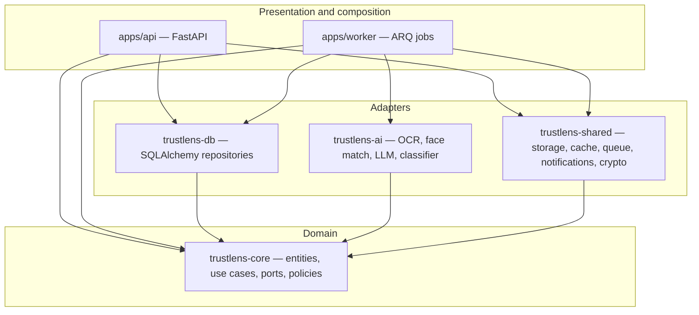

Dependency direction is inward-only: adapters depend on `trustlens-core`'s ports, never the reverse.
Enforced in CI by `import-linter` (Python, 6 contracts) and ESLint `no-restricted-imports` (TypeScript).

### 2.2 Component diagram — request path

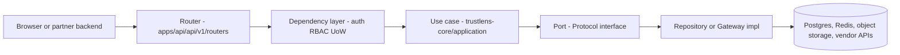

### 2.3 Layer responsibilities and prohibitions

| Layer                                                                     | Allowed to                                                                           | Forbidden from                                                                     |
| ------------------------------------------------------------------------- | ------------------------------------------------------------------------------------ | ---------------------------------------------------------------------------------- |
| Router (`apps/api/.../routers`)                                           | Parse/validate HTTP input, call one use case, map result to a response DTO           | Running business logic, querying the database directly, importing worker functions |
| Dependency (`apps/api/.../deps`)                                          | Resolve the authenticated actor, check RBAC, provide a request-scoped Unit of Work   | Making business decisions                                                          |
| Use case (`trustlens-core/application`)                                   | Orchestrate one business action, own the transaction boundary, publish domain events | Importing FastAPI, SQLAlchemy, or any vendor SDK                                   |
| Domain entity / policy (`trustlens-core/domain`)                          | Encode business invariants and pure rules                                            | Calling `datetime.now()`, `uuid4()`, I/O, or any adapter                           |
| Repository / Gateway (`trustlens-db`, `trustlens-ai`, `trustlens-shared`) | Implement a port against a real vendor/library                                       | Importing another adapter package, or being imported by `trustlens-core`           |
| Worker job (`apps/worker/jobs`)                                           | Call one use case per job, be idempotent, be retried safely                          | Holding cross-job state, non-idempotent side effects                               |

### 2.4 Why not microservices

One bounded context (seller trust), one two-person team, one release cadence. Microservices would add
network partitions, distributed transactions, and per-service CI for zero domain benefit at this
scale. The chosen shape is a **modular monolith with an out-of-process worker**: deployment stays
simple, and the package boundaries in §2.1 make later extraction mechanical — any adapter package can
become an HTTP service by re-implementing its port over the network, with no change to
`trustlens-core`.

---

## 3. Data design

### 3.1 Entity-relationship diagram

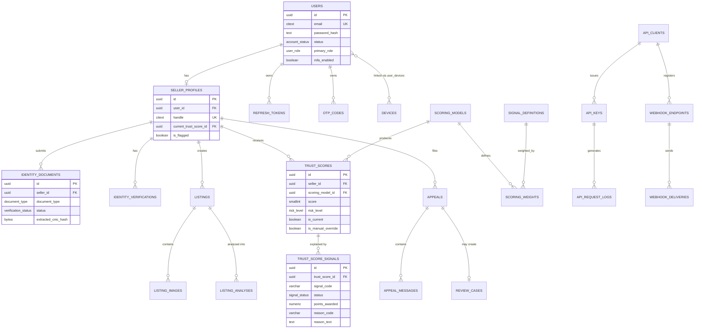

The full 40-table catalogue — every column, type, constraint, and index — is in
`docs/05-database-design.md`. This diagram shows the 13 tables that carry the product's core
narrative; cross-cutting tables (`files`, `audit_logs`, `job_runs`, `outbox_events`, `notifications`)
are omitted here for legibility and documented in §3.3.

### 3.2 Design conventions applied to every table

| Convention               | Rule                                                                                                |
| ------------------------ | --------------------------------------------------------------------------------------------------- |
| Primary key              | `UUID` (UUIDv7, time-ordered for index locality), never an auto-increment integer                   |
| Timestamps               | `created_at`/`updated_at` as `TIMESTAMPTZ NOT NULL DEFAULT now()` — always UTC                      |
| Soft delete              | `deleted_at TIMESTAMPTZ NULL` on business entities only, never on append-only evidence tables       |
| Optimistic locking       | `version INTEGER` on concurrently-edited rows (admin panel edits)                                   |
| Enums                    | Native PostgreSQL `ENUM` types — a new value is a migration, deliberately                           |
| Money                    | `NUMERIC(14,2)` + `currency CHAR(3)`, never floating point                                          |
| Semi-structured evidence | `JSONB` for vendor payloads; any column the scoring engine reads is promoted to a real typed column |

### 3.3 Data dictionary — core tables in full

#### `users`

| Column               | Type           | Constraints                             | Notes                                                  |
| -------------------- | -------------- | --------------------------------------- | ------------------------------------------------------ |
| id                   | uuid           | PK                                      | UUIDv7                                                 |
| email                | citext         | partial UNIQUE WHERE deleted_at IS NULL | Case-insensitive                                       |
| email_verified_at    | timestamptz    | NULL                                    | Drives the EMAIL signal                                |
| password_hash        | text           | NULL                                    | argon2id; NULL reserved for future OAuth-only accounts |
| status               | account_status | NOT NULL DEFAULT 'PENDING'              | PENDING/ACTIVE/SUSPENDED/BANNED/DELETED                |
| primary_role         | user_role      | NOT NULL DEFAULT 'BUYER'                | Denormalised; `user_roles` is authoritative            |
| mfa_enabled          | boolean        | NOT NULL DEFAULT false                  |                                                        |
| mfa_secret_encrypted | bytea          | NULL                                    | Envelope-encrypted                                     |
| failed_login_count   | smallint       | NOT NULL DEFAULT 0                      | Lockout counter                                        |
| locked_until         | timestamptz    | NULL                                    |                                                        |
| version              | integer        | NOT NULL DEFAULT 1                      | Optimistic locking                                     |

#### `seller_profiles`

| Column                                        | Type                | Constraints           | Notes                                                                                                                |
| --------------------------------------------- | ------------------- | --------------------- | -------------------------------------------------------------------------------------------------------------------- |
| id                                            | uuid                | PK                    |                                                                                                                      |
| user_id                                       | uuid                | FK→users, UNIQUE      | 1:1 with a user                                                                                                      |
| handle                                        | citext              | UNIQUE                | Public URL slug (`/seller/{handle}`)                                                                                 |
| current_trust_score_id                        | uuid                | FK→trust_scores, NULL | Denormalised current-score pointer, maintained inside the same transaction that writes `trust_scores` — cannot drift |
| identity_status / phone_status / email_status | verification_status |                       | Denormalised for fast dashboard reads                                                                                |
| is_flagged                                    | boolean             | DEFAULT false         | Under manual review                                                                                                  |

#### `identity_documents` / `identity_verifications`

The OCR half and the face-match half of Feature F1, split because they have independent failure
modes and evidence shapes.

| Column (identity_documents) | Type          | Notes                                                          |
| --------------------------- | ------------- | -------------------------------------------------------------- |
| document_type               | document_type | CNIC_FRONT / CNIC_BACK / SELFIE                                |
| ocr_confidence              | numeric(4,3)  | 0.000–1.000                                                    |
| extracted_cnic_encrypted    | bytea         | AES-256-GCM envelope encrypted                                 |
| extracted_cnic_hash         | bytea         | HMAC — enables duplicate-CNIC detection **without decrypting** |
| quality_score               | numeric(4,3)  | Blur/glare/crop gate                                           |

| Column (identity_verifications) | Type               | Notes                                                                                               |
| ------------------------------- | ------------------ | --------------------------------------------------------------------------------------------------- |
| face_similarity                 | numeric(5,4)       |                                                                                                     |
| threshold_used                  | numeric(5,4)       | Frozen at decision time — makes an old decision explainable even after the threshold is later tuned |
| decision_source                 | 'AUTO' \| 'MANUAL' |                                                                                                     |

#### `trust_scores` / `trust_score_signals` — the scoring core

| Column (trust_scores)                | Type           | Notes                                                                                                                                    |
| ------------------------------------ | -------------- | ---------------------------------------------------------------------------------------------------------------------------------------- |
| score                                | smallint       | `CHECK (score BETWEEN 0 AND 100)`                                                                                                        |
| risk_level                           | risk_level     | LOW/MEDIUM/HIGH/UNKNOWN                                                                                                                  |
| available_weight                     | numeric(6,3)   | Sum of weights actually evaluated                                                                                                        |
| cap_applied                          | smallint       | Which hard cap, if any, clamped the score                                                                                                |
| is_current                           | boolean        | Exactly one TRUE row per seller — enforced by `CREATE UNIQUE INDEX uq_trust_scores_current ON trust_scores (seller_id) WHERE is_current` |
| is_manual_override / override_reason | boolean / text | `CHECK (NOT is_manual_override OR override_reason IS NOT NULL)`                                                                          |

| Column (trust_score_signals)     | Type          | Notes                                        |
| -------------------------------- | ------------- | -------------------------------------------- |
| status                           | signal_status | PASS/PARTIAL/FAIL/UNAVAILABLE/NOT_APPLICABLE |
| points_awarded / points_possible | numeric(6,3)  |                                              |
| reason_code                      | varchar(60)   | Machine-readable, stable                     |
| reason_text                      | text          | Buyer-readable sentence                      |
| evidence                         | jsonb         | Non-PII supporting values                    |

**This is the explainability table.** For every score, every signal's status, weight, contribution,
reason code, human sentence, and an evidence pointer are frozen at computation time — answering "why
is this seller high risk" with zero recomputation and zero LLM dependency.

#### `scoring_models` / `scoring_weights`

`scoring_models` enforces **at most one active model** via a partial unique index. `scoring_weights`
links a model to a `signal_definitions` row with a weight and an optional `hard_cap_on_fail`. Weights
are database rows, not code, specifically so an admin can tune them without a redeploy, and so a
weight change is a versioned, auditable event rather than a silent behaviour shift.

### 3.4 Storage design

| Data class                      | Location                       | Encryption                                                       | Retention                       |
| ------------------------------- | ------------------------------ | ---------------------------------------------------------------- | ------------------------------- |
| CNIC images, selfies            | Object storage, private bucket | Bucket SSE + private ACL; reads via 5-minute presigned GETs only | 90 days after terminal decision |
| CNIC number, DOB                | Postgres `bytea` columns       | AES-256-GCM envelope encryption                                  | Life of account                 |
| Passwords                       | Postgres                       | argon2id (one-way)                                               | Life of account                 |
| OTP codes                       | Postgres                       | HMAC-SHA256 with a pepper held **outside** the database          | 300s TTL                        |
| Trust scores, signal breakdowns | Postgres                       | — (not sensitive; is the product's evidence trail)               | Indefinite                      |

Object storage keys are server-generated UUID paths — a user-supplied filename is stored only as
metadata, never used as a path, closing off path traversal by construction.

### 3.5 Index design highlights

| Table                                             | Index                                     | Serves                                                                                                                                                         |
| ------------------------------------------------- | ----------------------------------------- | -------------------------------------------------------------------------------------------------------------------------------------------------------------- |
| `identity_documents`                              | `(extracted_cnic_hash)`                   | **The single most valuable fraud-detection index in the schema** — finds one CNIC registered across many accounts in O(log n) while the number stays encrypted |
| `user_devices`                                    | `(device_id)`, `(user_id)`                | Multi-account-per-device clustering — the literal query behind FR-DEVICE-002                                                                                   |
| `trust_scores`                                    | `UNIQUE (seller_id) WHERE is_current`     | Structural guarantee of BR-01, not application discipline                                                                                                      |
| `access_events`, `api_request_logs`, `audit_logs` | Monthly range partitions on `occurred_at` | Retention becomes `DROP PARTITION` (instant) instead of a lock-holding `DELETE`                                                                                |

Full index catalogue: `docs/05-database-design.md` §5.

---

## 4. Data flow diagrams

### 4.1 Level 0 — context

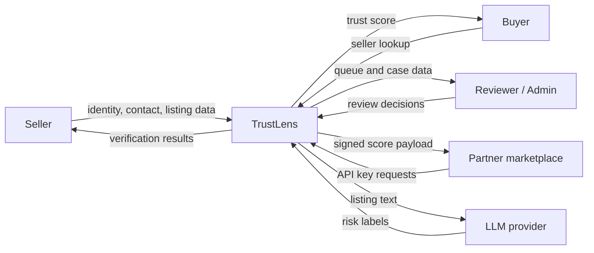

### 4.2 Level 1 — major processes

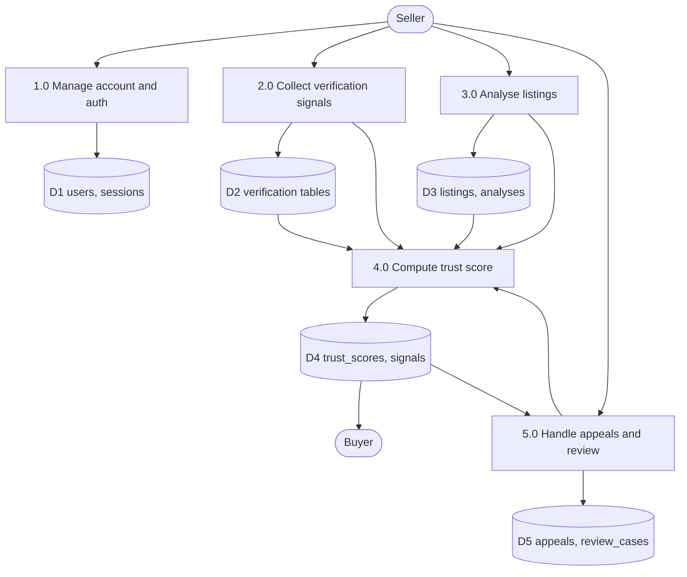

### 4.3 Level 2 — decomposition of Process 4.0 (Compute Trust Score, the most complex process)

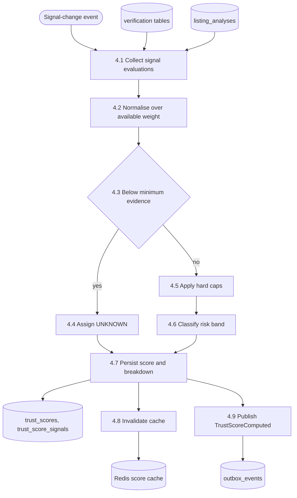

---

## 5. Component design

### 5.1 Repository layout (annotated)

```
trustlens-core/          domain + use cases + ports — imports nothing but stdlib and Pydantic
trustlens-db/            SQLAlchemy repositories implementing core ports
trustlens-ai/            OCR, face match, LLM, classifier adapters
trustlens-shared/        storage, cache, queue, notifications, crypto, clock, ids
apps/api/                FastAPI composition root — routers, deps, middleware, DI container
apps/worker/             ARQ composition root — jobs, cron, retry policy
apps/web/                Next.js — feature-sliced UI
apps/ml/                 offline training pipeline for the scam classifier
database/                Alembic migrations, hand-written seeds
```

Full annotated tree (every file, one line each): `docs/10-folder-structure.md`.

### 5.2 Core domain model (class diagram)

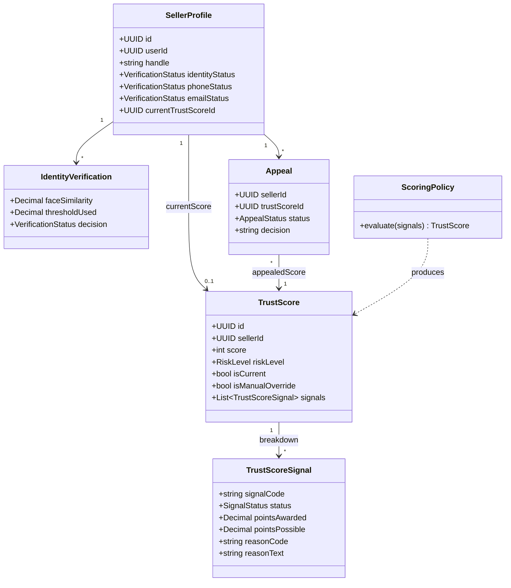

### 5.3 Service-module specification (representative)

| Module                                                                    | Key operation                           | Input                                                    | Output                                                | Failure behaviour                                                                                 |
| ------------------------------------------------------------------------- | --------------------------------------- | -------------------------------------------------------- | ----------------------------------------------------- | ------------------------------------------------------------------------------------------------- |
| `ComputeTrustScore` (use case)                                            | `execute(sellerId)`                     | Seller's current signal evaluations                      | New `TrustScore` + `TrustScoreSignal[]`               | Transaction rolls back on any write failure; no partial score is ever persisted                   |
| `SignalCollector` (service)                                               | `collect(sellerId)`                     | Repositories for identity, contact, device, listing data | List of per-signal evaluations with status/confidence | A single signal source failing marks that signal `UNAVAILABLE`, does not abort collection         |
| `SubmitIdentityDocuments` (use case)                                      | `execute(sellerId, fileIds, consentId)` | Uploaded file references                                 | `202` + job id                                        | Rejects if consent is missing or files fail validation, before any job is queued                  |
| `ResolveAppeal` (use case)                                                | `execute(appealId, decision, reason)`   | Reviewer/admin decision                                  | Updated appeal + triggered recompute/override         | An override without `reason` is rejected at the domain layer before it reaches the database CHECK |
| `EasyOcrEngine` / `RapidOcrEngine` (adapter, implements `OcrEngine` port) | `extract(image, documentType)`          | Image bytes                                              | `OcrResult` with confidence                           | Malformed image → typed `VerificationError`, never an unhandled exception reaching the job runner |

---

## 6. Interface design

### 6.1 API contract (representative subset — full list: `docs/06-api-design.md`)

| Method | Path                                         | Auth                           | Notes                                                   |
| ------ | -------------------------------------------- | ------------------------------ | ------------------------------------------------------- |
| POST   | `/api/v1/auth/register`                      | none                           | 201, no tokens until email verified                     |
| POST   | `/api/v1/auth/login`                         | none                           | Access token in body, refresh in httpOnly cookie        |
| POST   | `/api/v1/verification/identity`              | JWT                            | 202 + job id                                            |
| GET    | `/api/v1/sellers/{id}/trust-score`           | JWT                            | Full breakdown (own data or `:any` permission)          |
| POST   | `/api/v1/appeals`                            | JWT                            | Creates an appeal against a specific `trustScoreId`     |
| POST   | `/api/v1/admin/scoring-models/{id}/simulate` | JWT + `scoring_model:simulate` | Draft-model score-distribution preview                  |
| GET    | `/public/v1/sellers/{sellerRef}/trust-score` | API key, `score:read`          | PII-free response, `Cache-Control: public, max-age=300` |
| POST   | `/public/v1/sellers/lookup`                  | API key, `score:read`          | Batch, max 50 refs                                      |

### 6.2 Error/status-code design

| Code | Meaning in TrustLens specifically                                                                                                                                              |
| ---- | ------------------------------------------------------------------------------------------------------------------------------------------------------------------------------ |
| 202  | An AI-backed operation was accepted and queued — the response body always includes a pollable `jobId`                                                                          |
| 409  | Either an optimistic-locking version conflict, or a duplicate-registration collision                                                                                           |
| 410  | A revoked API key — deliberately distinct from 401, so a partner's monitoring can tell "your key is dead" from "your credentials are wrong"                                    |
| 422  | Either request-shape validation failure or a domain-state violation (e.g. appealing a score that no longer exists) — both use the same RFC 9457 shape, disambiguated by `code` |
| 429  | Rate limited; always carries `Retry-After` and `X-RateLimit-*`                                                                                                                 |
| 502  | An upstream AI provider failed — distinct from 500, so a partner or the frontend can tell "our bug" from "a vendor's outage"                                                   |

### 6.3 Client-side interface rules

A single generated, typed client (`packages/api-client`, from the backend's OpenAPI document) is the
**only** way the frontend calls the API. A backend field rename breaks the frontend type-check, not
production. `lib/api/interceptors.ts` centralises the 401 → refresh-once → retry-once → logout flow
and maps every `application/problem+json` error to one `AppError` shape used uniformly by every
feature.

---

## 7. Behavioural design

### 7.1 Sequence — seller identity verification (the critical path)

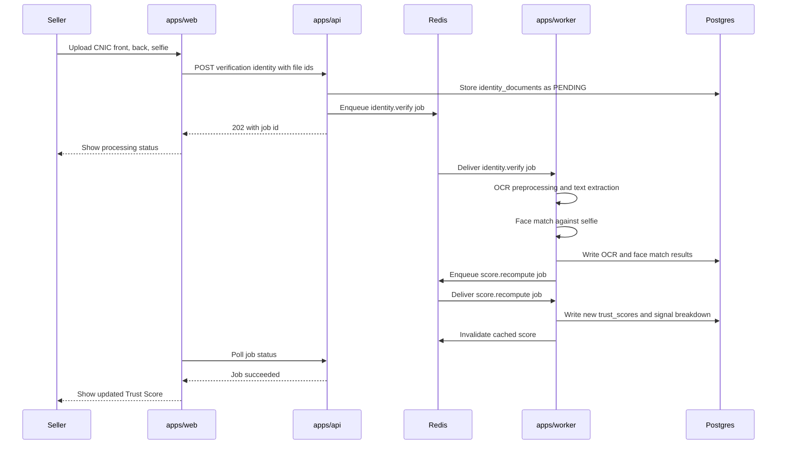

### 7.2 Sequence — partner reads a score, including a degraded path

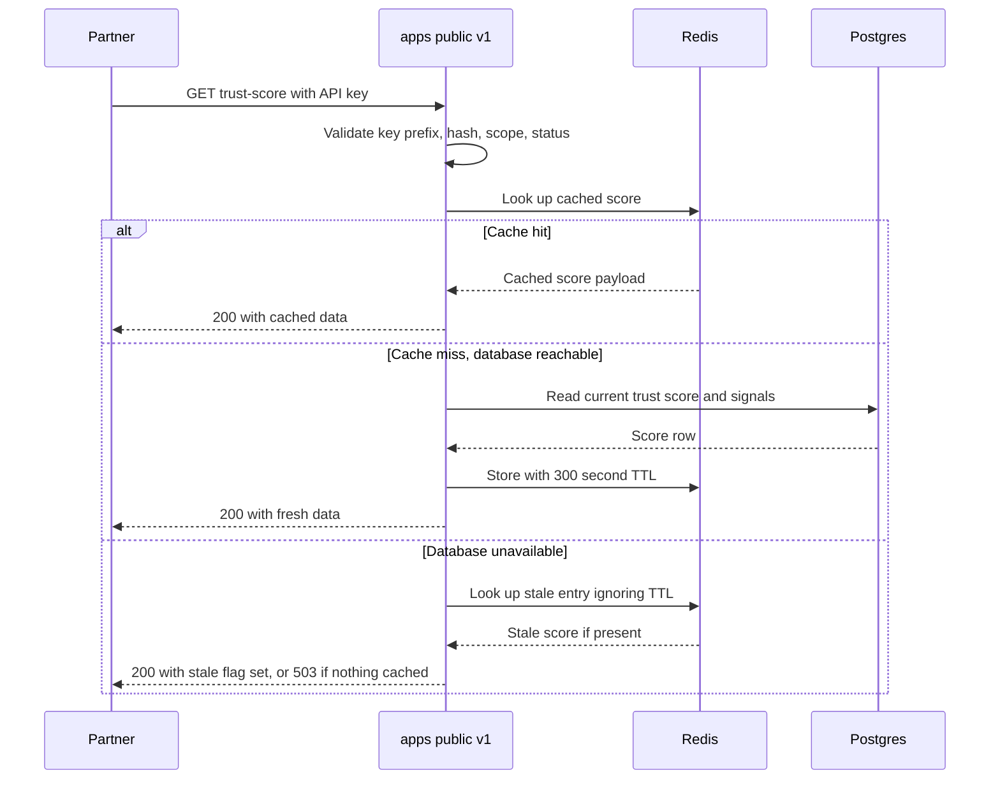

### 7.3 Sequence — refresh-token reuse detection (security-critical)

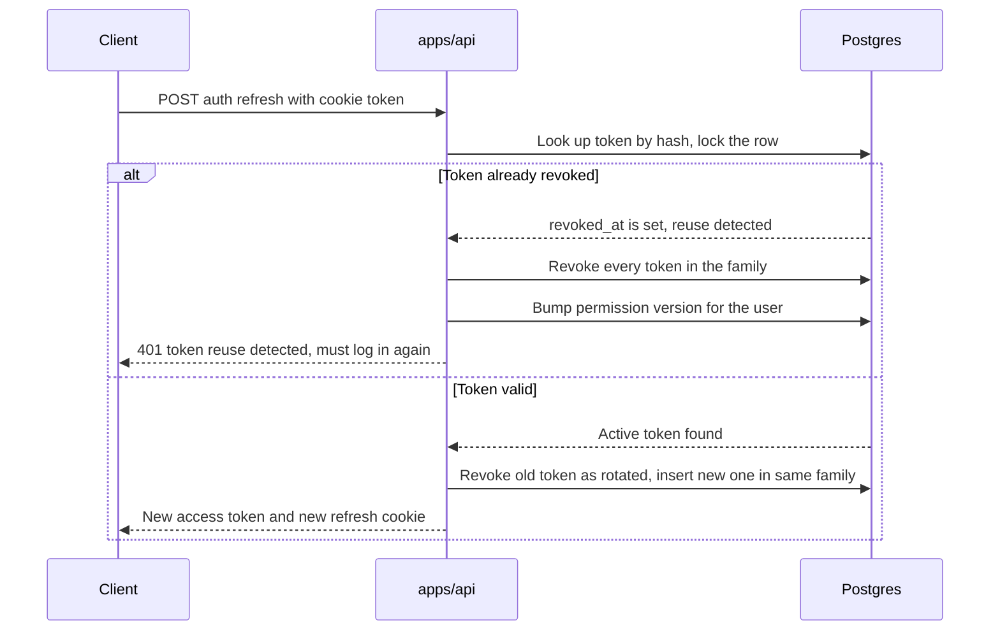

### 7.4 State diagram — verification status lifecycle

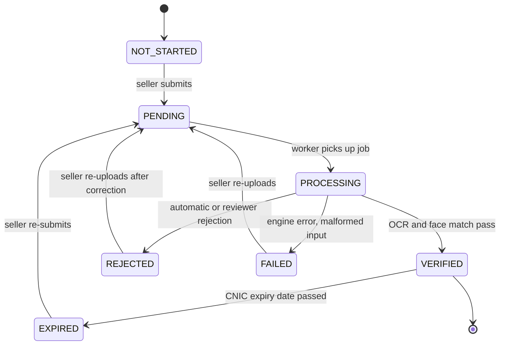

### 7.5 State diagram — appeal lifecycle

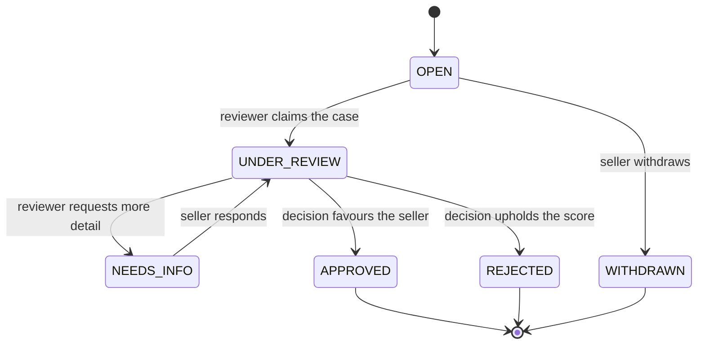

---

## 8. Algorithm design

### 8.1 Trust Score computation (pseudocode)

```
function computeTrustScore(sellerId):
    signals = SignalCollector.collect(sellerId)          # one evaluation per active signal_definition

    availableWeight = sum(s.pointsPossible for s in signals
                          if s.status not in {UNAVAILABLE, NOT_APPLICABLE})
    earned = sum(s.pointsAwarded for s in signals)

    if availableWeight < MIN_EVIDENCE_WEIGHT:             # default 40
        return TrustScore(score=0, riskLevel=UNKNOWN, reason=INSUFFICIENT_EVIDENCE)

    rawScore = (earned / availableWeight) * 100

    capApplied = null
    for signal in signals:
        if signal.isCritical and signal.status == FAIL:
            cap = hardCapFor(signal.code)
            if capApplied is null or cap < capApplied:
                capApplied = cap

    score = round(clamp(rawScore, 0, 100))
    if capApplied is not null:
        score = min(score, capApplied)

    riskLevel = bandFor(score)                            # LOW 70-100, MEDIUM 40-69, HIGH 0-39
    confidence = weightedMeanConfidence(signals) * (availableWeight / 100)

    persist TrustScore(score, riskLevel, capApplied, confidence, isCurrent=true)
    persist one TrustScoreSignal row per evaluated signal
    flip the previous current score to isCurrent=false, in the same transaction
    return the new TrustScore
```

Complexity: O(n) in the number of active signal definitions (14 in the seeded model) — the algorithm
does not scale with seller count per invocation, which is why per-seller recomputation stays
sub-5-second even without special-casing.

### 8.2 Device-linkage suspicion (pseudocode)

```
function deviceLinkageStatus(deviceId):
    linkedAccountCount = count(distinct userId in user_devices where device_id = deviceId)
    if linkedAccountCount <= 2:
        return PASS
    else:
        return FAIL   # feeds DEVICE_NOT_SHARED, and independently a review_case if count >= 4
```

### 8.3 Face-match decision banding (pseudocode)

```
function faceMatchDecision(similarity, threshold=0.70, reviewLower=0.55):
    if similarity >= threshold:
        return PASS
    elif similarity >= reviewLower:
        return MANUAL_REVIEW        # never an automatic FAIL in this band — see NFR-SAFE-03
    else:
        return FAIL                 # triggers the IDENTITY_FACE_MATCH hard cap
```

### 8.4 Score-freshness / staleness sweep

```
nightly cron:
    for each trust_scores row where is_current and valid_until < now():
        enqueue score.recompute for that seller
```

Runs against `SCORE_VALIDITY_DAYS` (30, assumption A14); ensures a seller's public score never
silently ages past its stated validity window even with no signal change.

---

## 9. Security design

### 9.1 Authentication and authorisation flow

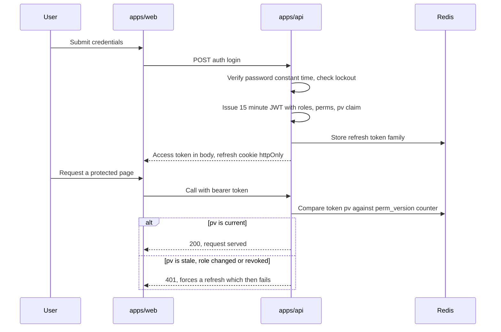

### 9.2 Defence-in-depth table

| Layer       | Control                                                      | Implementation                                                                                          |
| ----------- | ------------------------------------------------------------ | ------------------------------------------------------------------------------------------------------- |
| Network     | TLS 1.2+, HSTS, strict CSP                                   | Platform-terminated TLS + `SecurityHeadersMiddleware`                                                   |
| Edge        | Route-group guard before any JS ships                        | Next.js `middleware.ts`                                                                                 |
| Application | RBAC + mandatory object-level ownership checks               | `require_permissions`, `require_ownership` dependencies                                                 |
| Application | Deny-by-default routing                                      | Startup assertion walks every route and fails the boot if any non-public route lacks an auth dependency |
| Data        | Envelope encryption for CNIC/DOB, hashed OTPs/tokens         | AES-256-GCM, HMAC-SHA256 with an out-of-database pepper                                                 |
| Upload      | Magic-byte sniffing, re-encode, EXIF strip, dimension bounds | Pillow/OpenCV pipeline behind a presigned-upload flow                                                   |
| Abuse       | Per-identity rate limiting, idempotency keys                 | Redis token bucket; `Idempotency-Key` replay protection                                                 |
| Audit       | Append-only log of every state-changing action               | `AuditingUnitOfWork` decorator, no update/delete path                                                   |

### 9.3 Known limitations (stated honestly)

| Limitation                                               | Accepted because                                                                                                                                         | Revisit if                                                                                               |
| -------------------------------------------------------- | -------------------------------------------------------------------------------------------------------------------------------------------------------- | -------------------------------------------------------------------------------------------------------- |
| MFA is designed but not implemented for ADMIN/REVIEWER   | Enrollment flow was never built; the flag exists but is inert (fixed from a worse prior state where it caused a hard login lockout — see the defect log) | Before any production deployment holding real identity documents                                         |
| IP-reputation defaults to an offline ASN/datacenter list | No paid key is available at FYP budget; the offline fallback still detects the common datacenter/hosting-provider case                                   | A paid key is provisioned                                                                                |
| No independent penetration test performed                | Out of budget/time for a 2-person FYP team                                                                                                               | Before production launch — `docs/15-security.md` §13 is the pre-submission checklist that should gate it |

### 9.4 Prompt-injection resistance (T6, worth its own diagram given the domain)

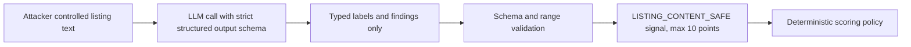

The worst a successful injection achieves is a wrong label on one 10-point signal — visible in the
breakdown and directly appealable, because the LLM never sets a score, only evidence.

---

## 10. Error handling and degradation design

### 10.1 Fail-fast vs. degrade-and-continue vs. hard failure

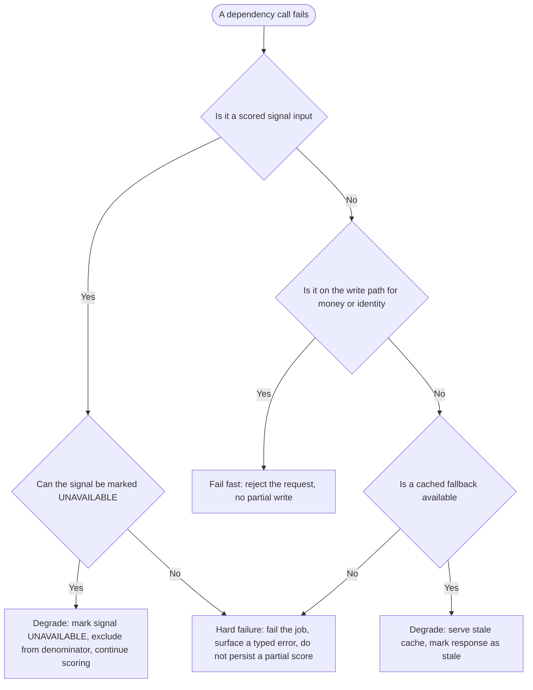

### 10.2 Failure-mode mapping

| Failure                                   | Classification                                         | Actual behaviour                                                                                                |
| ----------------------------------------- | ------------------------------------------------------ | --------------------------------------------------------------------------------------------------------------- |
| LLM provider down/rate-limited            | Degrade                                                | `LISTING_CONTENT_SAFE` marked `UNAVAILABLE`, excluded from denominator, not scored as zero                      |
| DeepFace/EasyOCR crash on malformed image | Hard failure                                           | Job fails cleanly, document status `FAILED`, user-facing reason, no partial score                               |
| IP-intel provider unreachable             | Degrade                                                | Falls back to offline ASN/datacenter list, confidence lowered                                                   |
| Redis down                                | Degrade (reads) / fail fast (public-API rate limiting) | API serves from Postgres; public API rate limiting fails **closed**, internal auth rate limiting fails **open** |
| Postgres down                             | Degrade                                                | Public API serves stale cached score with `X-TrustLens-Stale: true`; writes return 503                          |
| Worker backlog                            | Degrade                                                | Queue depth alerts; API keeps accepting and can report an honest queue-position estimate                        |

---

## 11. Deployment design

### 11.1 Deployment diagram (as designed — not yet live, see §11.3)

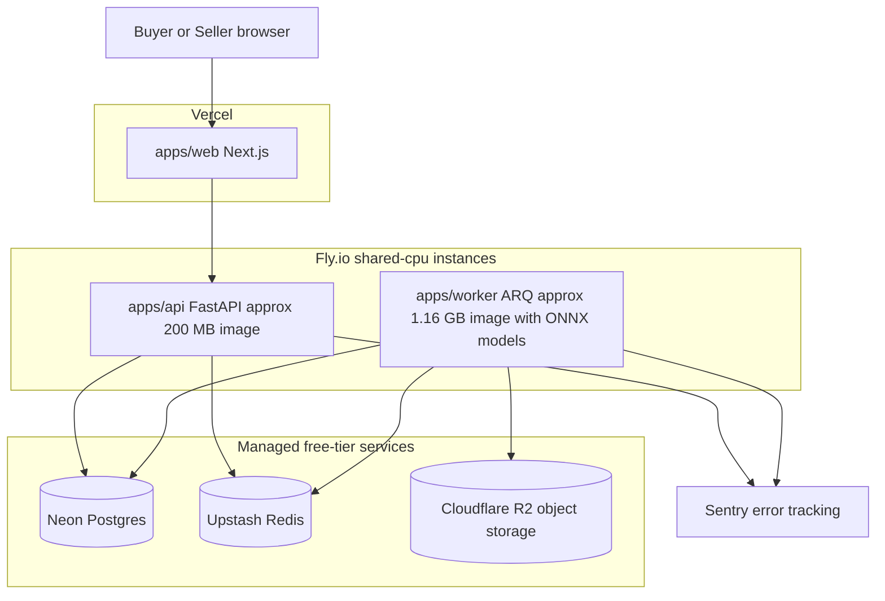

### 11.2 Environment matrix

| Variable                | Development                       | Production (designed)                                                                          |
| ----------------------- | --------------------------------- | ---------------------------------------------------------------------------------------------- |
| `DEBUG`                 | true                              | false (asserted at startup)                                                                    |
| `USE_FAKE_AI`           | optional, `dev-offline` sets true | false                                                                                          |
| Database                | local Docker Postgres             | Neon (managed, sleeps after 5 min idle — must be pinged before a demo)                         |
| Redis                   | local Docker                      | Upstash (closes idle connections — the worker has an explicit reconnect/backoff loop for this) |
| `SECURITY_CORS_ORIGINS` | `localhost:3000`                  | production domain only, wildcard rejected at boot                                              |
| Swagger `/docs`         | on                                | off for the internal API                                                                       |

Full variable reference: `docs/12-environment-variables.md`.

### 11.3 Deployment status (stated plainly)

**Nothing is deployed to a public URL as of this document.** The architecture and the specific host
choice (Fly.io + Neon + Upstash + R2, chosen 12 August 2026 to reach a genuine $0/month footprint —
see `docs/20-go-live-plan.md`) are designed and partly rehearsed (the ONNX worker image was built and
measured at 1.16 GB / 323 MB peak RAM), but the actual `fly deploy` has not run. This diagram
describes the target shape, not a live system, and the thesis's Results chapter states this
distinction explicitly rather than implying a deployment that has not happened.

---

## 12. Design decisions and rationale

| Decision                                                                                                                                            | Alternatives considered                                                                                                                                | Why this one won                                                                                                                                                                                                                                                  |
| --------------------------------------------------------------------------------------------------------------------------------------------------- | ------------------------------------------------------------------------------------------------------------------------------------------------------ | ----------------------------------------------------------------------------------------------------------------------------------------------------------------------------------------------------------------------------------------------------------------- |
| ARQ over Celery/RQ/Dramatiq/`BackgroundTasks`                                                                                                       | Celery (heavier config), RQ, Dramatiq, FastAPI `BackgroundTasks`                                                                                       | Asyncio-native (matches FastAPI), reuses the Redis the proposal already mandates; `BackgroundTasks` was disqualified outright — work would die with the process                                                                                                   |
| SQLAlchemy 2.0 async + Alembic                                                                                                                      | Prisma (Python), Tortoise, raw asyncpg                                                                                                                 | Mature migrations, typed 2.0 style, escape hatch to raw SQL for analytics reads                                                                                                                                                                                   |
| Deterministic rule engine scores; AI supplies evidence (ADR-0002)                                                                                   | Let the LLM output the score directly                                                                                                                  | Appealability and reproducibility are structurally impossible if the score-setter is non-deterministic                                                                                                                                                            |
| API and worker as separate processes sharing one codebase (ADR-0003)                                                                                | One FastAPI monolith including the ML stack                                                                                                            | A single image would carry torch/tensorflow into the API's cold-start path and every deploy; splitting the _process_, not the _codebase_, gives isolation without microservice overhead                                                                           |
| Framework-free domain package with ports (ADR-0004)                                                                                                 | Business logic directly in FastAPI route handlers / SQLAlchemy models                                                                                  | The same `ComputeTrustScore` use case must run identically from an HTTP route, a background job, and a test with an in-memory fake — impossible if it imports FastAPI                                                                                             |
| Weights and thresholds stored in the database, versioned (ADR-0007)                                                                                 | Hard-coded constants in the scoring policy code                                                                                                        | An FYP demo needs live weight tuning during evaluation; a supervisor may challenge a specific weight, and the answer must be "we adjusted it and re-simulated," not "we'd need a redeploy"                                                                        |
| pnpm + Turborepo (JS) / uv (Python) polyglot monorepo (ADR-0001)                                                                                    | Nx (steeper learning curve than a 2-person FYP needs), Bazel (correct for polyglot but disproportionate), polyrepo (breaks atomic cross-stack commits) | A backend response-shape change and its frontend consumer land in one commit, one PR, one CI run                                                                                                                                                                  |
| RapidOCR/InsightFace (ONNX) added alongside EasyOCR/DeepFace, not replacing them                                                                    | Replace outright and drop the heavier pair                                                                                                             | Neither pair has been benchmarked against real CNIC images yet (P1-01/P1-06 outstanding); keeping both lets Phase 1 choose on **measured** accuracy rather than assumption                                                                                        |
| Public buyer page served by a new first-party internal route (`/api/v1/public/sellers/{ref}/trust-score`), not a partner API key held by `apps/web` | Give `apps/web` its own partner API key                                                                                                                | A revoked/exhausted partner key would take the demo's own opening screen down with it — the fix that resolved defect P0-12 reuses the same use case and response model as the real partner API, so the PII-free guarantee is inherited rather than re-implemented |

---

## Appendix — Design traceability (SRS → SDD)

| SRS requirement              | SDD section                                                    |
| ---------------------------- | -------------------------------------------------------------- |
| FR-SCORE-001 through 011     | §3.3 (trust_scores/signals), §8.1 (algorithm), §7.1 (sequence) |
| FR-IDENT-001 through 010     | §3.3 (identity tables), §7.1, §9.1                             |
| NFR-SEC-01 through 07        | §9 (security design)                                           |
| NFR-SAFE-01 through 03       | §8.3, §10                                                      |
| C9 (AI never sets the score) | §9.4, ADR-0002 reference in §12                                |

## Appendix — Revision history

| Version | Date       | Change                                                           |
| ------- | ---------- | ---------------------------------------------------------------- |
| 1.0     | 2026-08-31 | Initial SDD authored against the built system for FYP submission |
