# User Manual

**TrustLens — AI-Powered Seller Trust Verification System for Online Marketplaces**

---

## Important notice — please read first

TrustLens checks whether a seller's identity documents are internally consistent and whether a
selfie matches the photo on those documents. **It does not verify a seller's identity against any
government database** (there is no public NADRA API available for this purpose), and it does not
guarantee that a seller is honest, only that certain independent checks passed or failed. Always use
your own judgement in addition to a Trust Score before making a payment. TrustLens processes national
identity documents and biometric face data — you must give explicit consent before uploading them,
and you may request export or deletion of your data at any time (see §8).

---

## 1. What TrustLens does

TrustLens gives you one number from 0 to 100 — the **Trust Score** — for an online marketplace
seller, along with a risk band (LOW / MEDIUM / HIGH / UNKNOWN) and the specific reasons behind it.
Sellers earn the score by completing identity, phone, email, and device checks; buyers use it to
decide whether to trust a seller before paying.

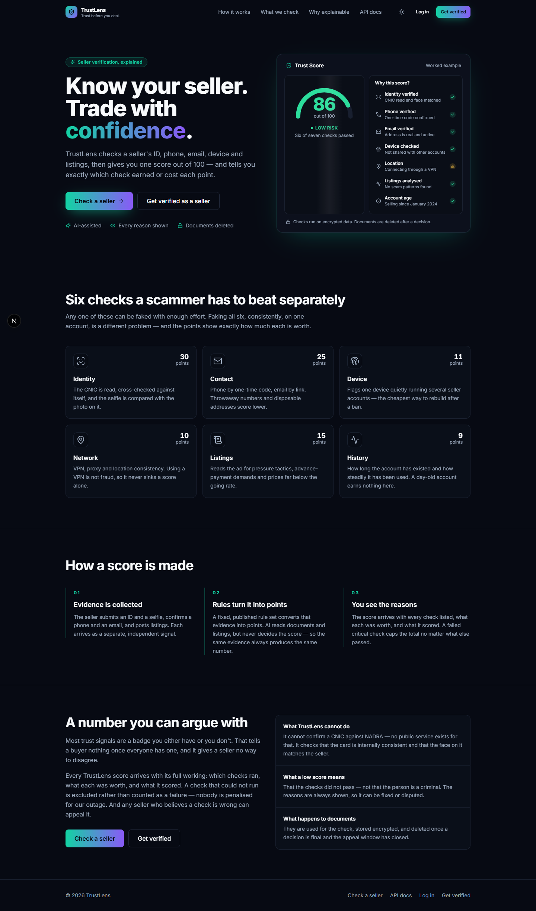

_The landing page shows a worked example of a full Trust Score breakdown, so you can see exactly what
you'll get before creating an account._

## 2. Before you begin

| You need                                      | Notes                                                              |
| --------------------------------------------- | ------------------------------------------------------------------ |
| A modern browser                              | Chrome, Firefox, Safari, or Edge — desktop or mobile               |
| An email address                              | Verification is required before you can sign in                    |
| A phone number                                | For OTP verification (a seller-only requirement)                   |
| Your CNIC (front and back) and a clear selfie | For seller identity verification only — buyers never need this     |
| Image files under 10 MB, JPEG/PNG/WEBP        | Larger files or other formats are rejected before upload completes |

You do **not** need an account to look up a seller's score as a buyer — see §5.

## 3. Getting started — creating an account

1. Go to the TrustLens homepage and click **Get verified** (to register as a seller) or **Check a
   seller** (to look someone up without an account).
2. Fill in your full name, email, and a password of at least 12 characters.
3. Choose whether you want to sell (and earn a Trust Score) or just browse as a buyer.
4. Accept the terms and privacy policy, then click **Create account**.

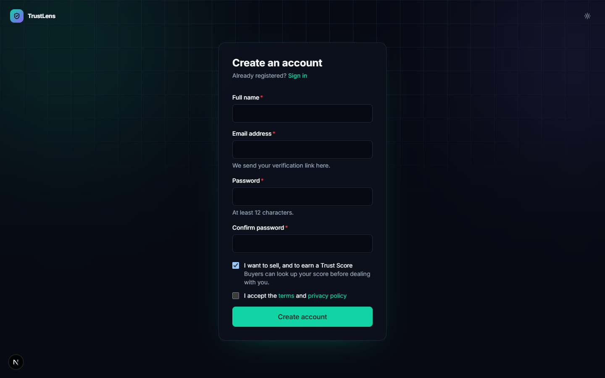

5. Check your email for a verification link. **You cannot sign in until you click it** — this is
   intentional, not a bug, and it's one of the checks that contributes to a seller's score.
6. Return to TrustLens and sign in with your email and password.

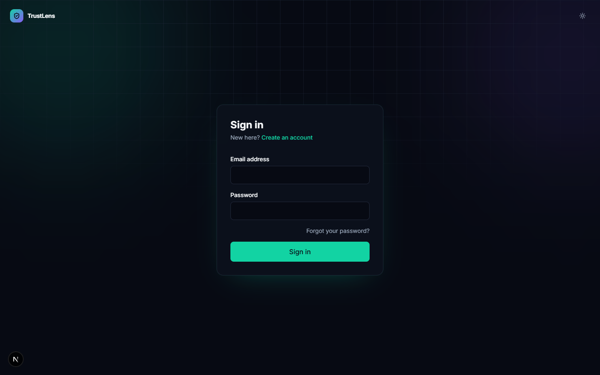

## 4. The seller dashboard

Once signed in as a seller, your dashboard is where everything starts.

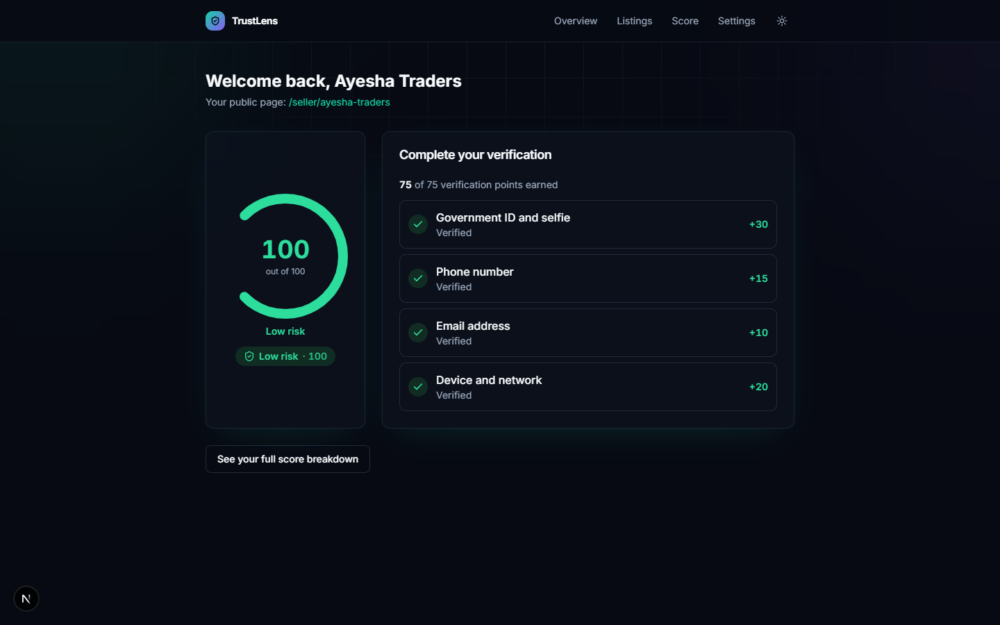

From here you can start verification, add listings, and see your current Trust Score.

## 5. Completing verification

### 5.1 The checklist

Open **Verification** from your dashboard to see all four checks and how many points each is worth.

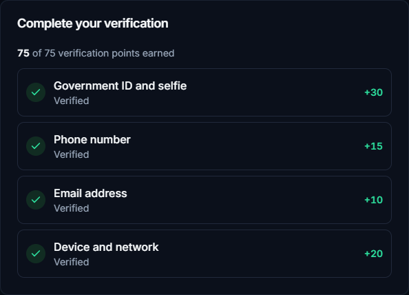

### 5.2 Identity verification (worth the most points)

1. Read and accept the biometric-processing consent notice — this is required by law and by design,
   since your face and ID data are sensitive.
2. Upload a clear photo of the **front** of your CNIC, the **back** of your CNIC, and a **selfie**
   taken facing the camera in good light.
3. Wait while the system reads your CNIC and compares your selfie to the photo on it — this takes
   roughly 15–30 seconds. Don't close the tab; a progress indicator shows the current stage.
4. Review the details the system read off your CNIC. If anything was misread, correct it before
   confirming.
5. You'll be notified of the result. If your selfie is a close-but-not-certain match, a human
   reviewer checks it manually rather than an automatic system deciding — this can take longer but is
   there to be fair to you.

**Caveats:**

- An expired CNIC is rejected as a distinct failure from a blurry-photo failure — check the expiry
  date before uploading.
- Your uploaded CNIC and selfie images are automatically deleted 90 days after a final decision. The
  score itself, and the fact that you were verified, are kept — just not the raw images.
- If your identity check fails, your overall score is capped low regardless of your other checks,
  since identity is the hardest signal to fake and the most important one to get right.

### 5.3 Phone verification

1. Enter your phone number.
2. You'll receive a 6-digit code by SMS. Enter it within a few minutes.
3. You get up to 5 attempts per code, and up to 3 new codes per hour — this limit exists to stop the
   feature being used to spam SMS costs onto TrustLens, not to inconvenience you.

**Caveat:** an internet-routed (VOIP) number is treated less favourably than a real mobile SIM,
because throwaway VOIP numbers are a known scam pattern.

### 5.4 Email verification

Your login email is verified automatically as part of registration (§3). You can optionally add a
second business email under Settings.

**Caveat:** email addresses from known temporary/disposable-email providers score lower — use an
address you actually control long-term.

### 5.5 Device and network (automatic — nothing to do)

TrustLens quietly records information about your device and connection each time you sign in. You
can review what's linked to your account under **Settings → Devices**. If you regularly use a VPN,
your score may show a network warning — this is not automatically treated as fraud, but it is shown
transparently.

## 6. Your Trust Score

Open **Score** from your dashboard at any time to see your current score, its risk band, and a full
breakdown.

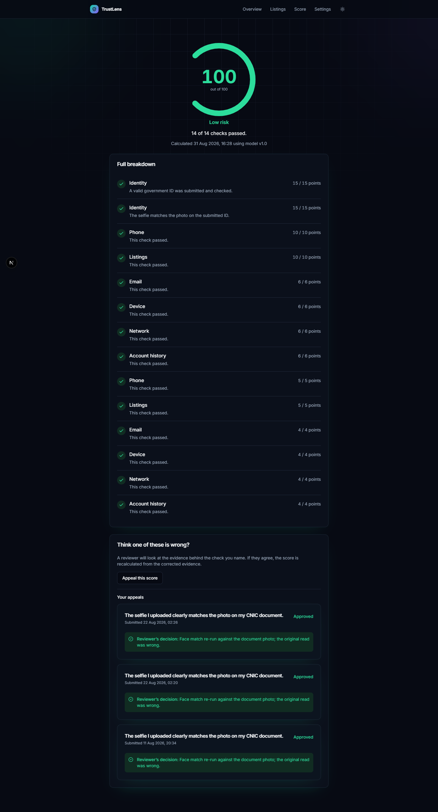

_A fully-verified seller: every check passed, and the score sits in the LOW-risk (green) band._

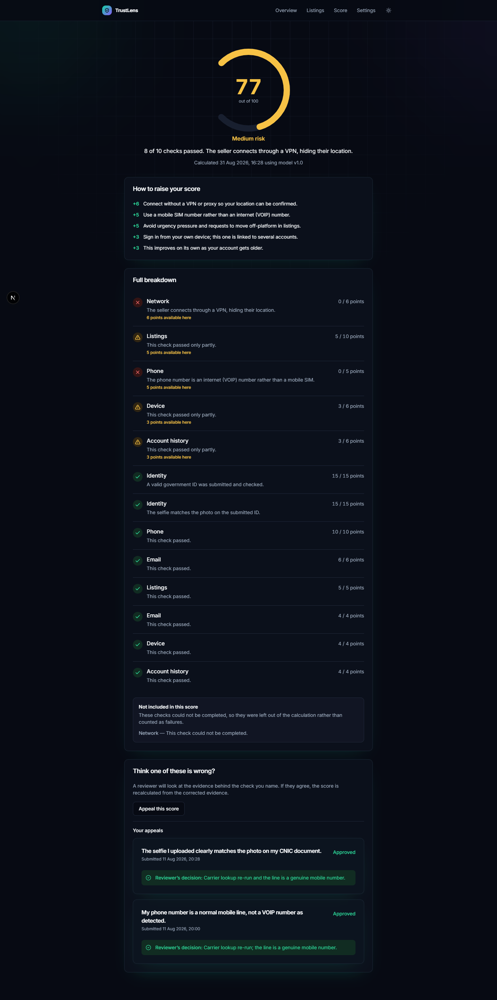

_A partially-verified seller: some checks are still outstanding or failed, landing in the
MEDIUM-risk (amber) band, with the exact reasons listed._

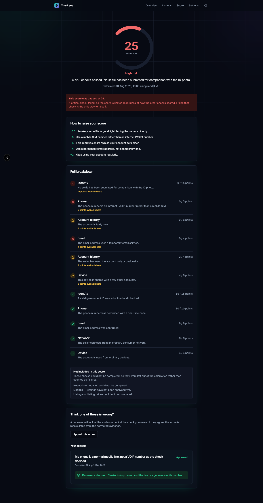

_When a critical check (like identity) fails, the score is deliberately capped — the page states this
plainly rather than showing a confusingly low number with no explanation, and tells you exactly which
check to fix._

Under **How to raise your score**, you'll see the specific unearned points ranked by value, with the
action that would earn each one — this is the fastest way to see what to do next.

### Appealing a score

If you believe a specific check is wrong, scroll to the bottom of your Trust Score page and click
**Appeal this score**. State your reason; a human reviewer will look at the same evidence the system
saw (not just take your word for it) and either recompute your score, correct it, or explain why it
stands. You can have at most one open appeal at a time, and up to three in any 30-day period.

## 7. Looking up a seller as a buyer

You do not need an account for this.

1. Visit `trustlens.app/seller/{their-handle}` (a seller can share this link with you directly, or you
   can search on the **Check a seller** page).
2. You'll see their score, risk band, and the specific reasons — the same explanation a seller sees
   about their own score, minus anything private.

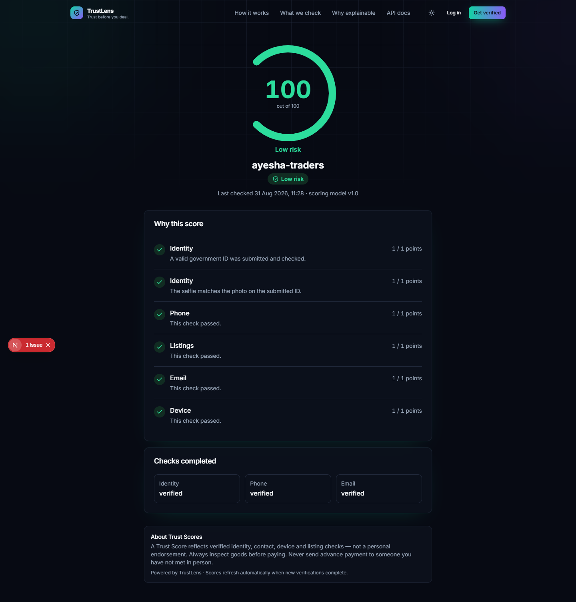

This page also works correctly on a phone:

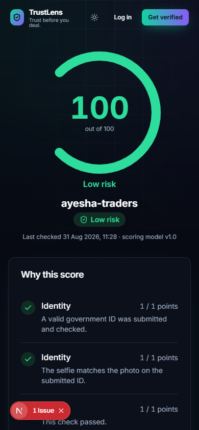

**If a seller isn't on TrustLens at all**, the page tells you plainly that there's no record for
them — it never invents or implies a score for a seller who hasn't gone through verification.

## 8. Account settings, data export, and deletion

Under **Settings**, you can change your password, review and sign out individual devices/sessions,
and request an export or deletion of your data. Deleting your account removes your personal
information and documents, but — to protect other buyers — an anonymised record that you once had a
particular risk history is retained, so a banned scammer cannot simply delete their account and start
over with a clean slate.

## 9. For staff (reviewers and admins)

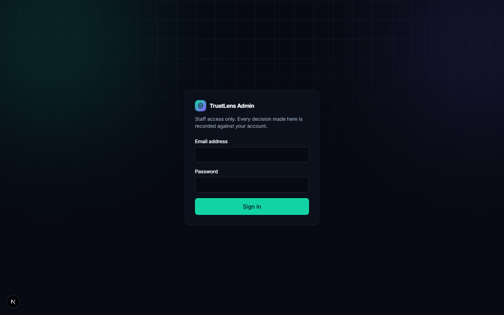

Reviewers and admins sign in separately and see a queue of pending identity reviews and flagged
sellers, ordered by priority and age.

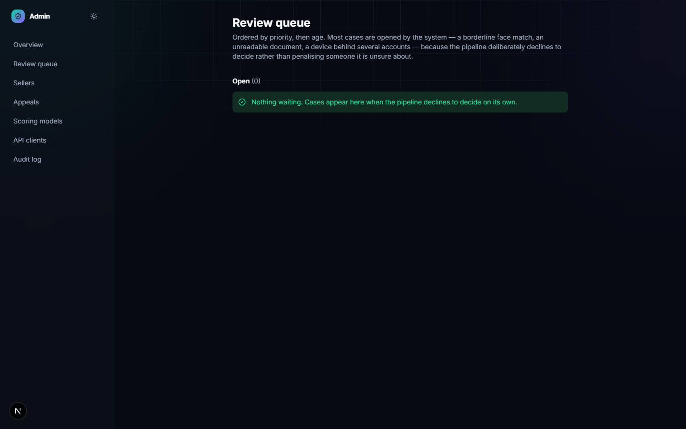

A reviewer can approve or reject an identity submission (with a reason) and resolve appeals. Only an
admin can directly override a Trust Score, and only with a written reason — this is a deliberate
separation of duties, not a missing feature. **As of this manual, only the review queue and
scoring-model management screens are complete; seller search, seller detail pages, and the audit-log
viewer are still being built.**

## 10. Troubleshooting

Error messages below are reproduced as the system actually shows them, not paraphrased.

| What you see                                                                          | What it means                                                                                                                        | What to do                                                                                           |
| ------------------------------------------------------------------------------------- | ------------------------------------------------------------------------------------------------------------------------------------ | ---------------------------------------------------------------------------------------------------- |
| `EMAIL_NOT_VERIFIED` on sign-in                                                       | You haven't clicked the verification link sent to your email yet                                                                     | Check your inbox (and spam folder), click the link, then try signing in again                        |
| A generic "invalid email or password" on login                                        | Either your credentials are wrong, or the account doesn't exist — TrustLens intentionally doesn't say which, to protect your privacy | Double-check your details; use "forgot password" if needed                                           |
| "Too many attempts, try again later"                                                  | You've hit a rate limit (e.g. too many login attempts, too many OTP codes requested)                                                 | Wait for the stated time before retrying — this is a security protection, not an error               |
| CNIC upload rejected immediately                                                      | The file failed a format/size check before it was even processed                                                                     | Use a JPEG, PNG, or WEBP file under 10 MB — and make sure the file actually is an image, not renamed |
| "The submitted ID has expired"                                                        | Your CNIC's expiry date has passed                                                                                                   | Upload a currently valid CNIC                                                                        |
| "The selfie does not clearly match the photo on the submitted ID"                     | The face-match check failed                                                                                                          | Retake your selfie in good, even lighting, facing the camera directly, with your face unobstructed   |
| Your case is "under manual review" for longer than expected                           | Your face-match result was borderline and was deliberately routed to a human reviewer rather than an automatic decision              | This is working as intended — it typically resolves within one business day                          |
| "Not enough checks have been completed to judge this seller" (score shown as UNKNOWN) | The seller (possibly you) hasn't completed enough verification yet for a score to be meaningful                                      | This is not a bad score — it's an honest "not enough evidence yet" state                             |
| A public seller page says there's no record for that seller                           | The seller you searched for has never enrolled with TrustLens                                                                        | TrustLens can only score sellers who have gone through its verification process                      |

## 11. Frequently asked questions

**Is a high Trust Score a guarantee the seller is honest?**
No. It means several independent checks passed. Still use your own judgement, especially for
high-value transactions.

**Why did my score go down without me doing anything?**
Scores are recalculated automatically whenever something relevant changes — for example, if your
CNIC's expiry date passes, or a scoring rule is updated by an admin. Check your score breakdown for
the specific reason.

**Can I see exactly why I lost points?**
Yes — every point, earned or not, has a stated reason. That's the entire point of the design.

**Why does the system need my selfie AND my ID photo?**
The selfie confirms that the person uploading the documents is the person shown on them — without it,
anyone could upload someone else's ID.

**What happens to my ID photos after I'm verified?**
They're stored encrypted and privately, and automatically deleted 90 days after your verification
decision is finalised. Your verification _status_ is kept; the raw images are not.

**Can a marketplace check my score automatically?**
Yes — that's what the public API is for. A marketplace partner can look up your score
programmatically, using the same public information a buyer would see (no private data).

**Why is a VPN treated as a negative signal? I use one for privacy.**
Using a VPN is not itself treated as proof of fraud — it's one signal among many, shown transparently,
and it does not by itself cap your score the way a failed identity check does.

## 12. Glossary

| Term        | Meaning                                                 |
| ----------- | ------------------------------------------------------- |
| Trust Score | The 0–100 number TrustLens gives a seller               |
| Risk band   | LOW / MEDIUM / HIGH / UNKNOWN, derived from the score   |
| Signal      | One individual check contributing to the score          |
| OTP         | The one-time code sent to verify a phone number         |
| Appeal      | A formal request for a human to review a specific score |
| Handle      | A seller's public URL slug, e.g. `ayesha-traders`       |
